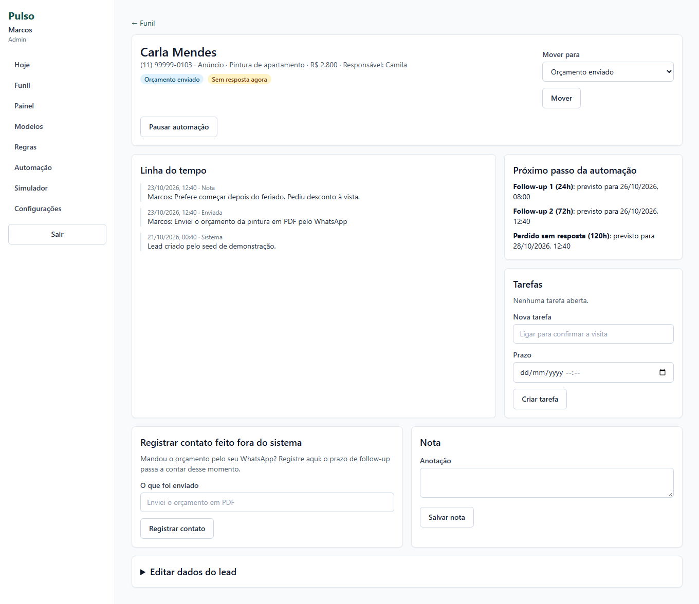
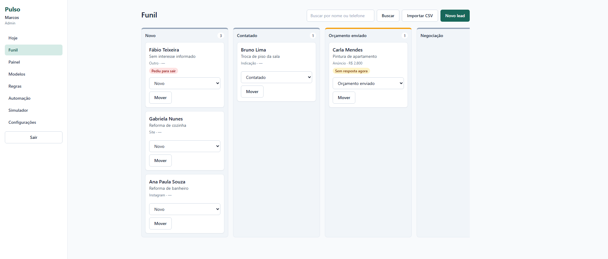
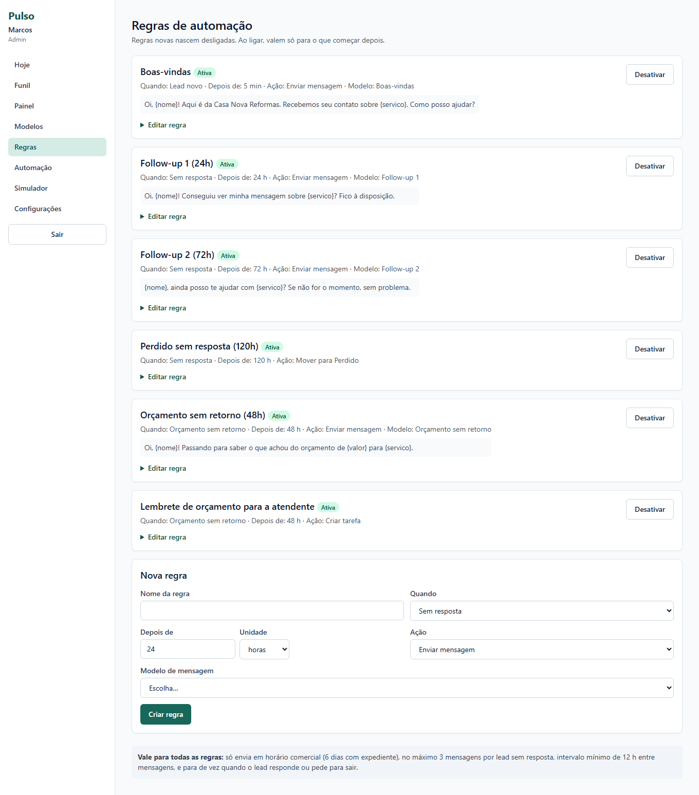
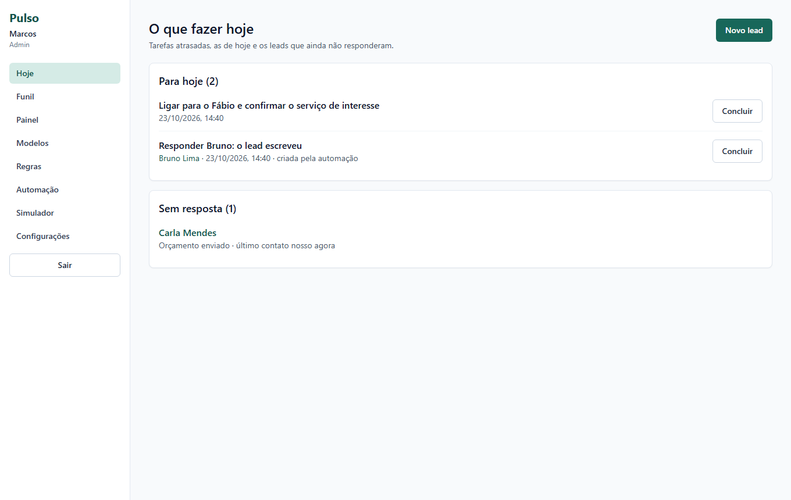
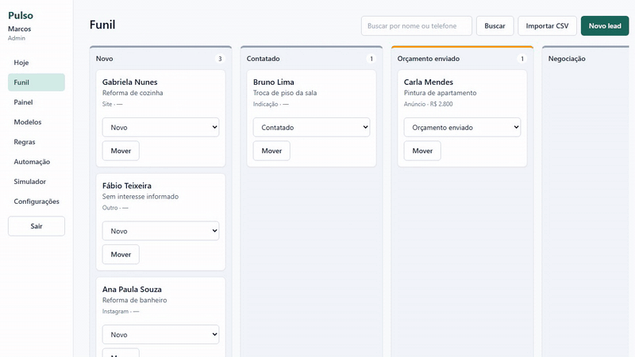
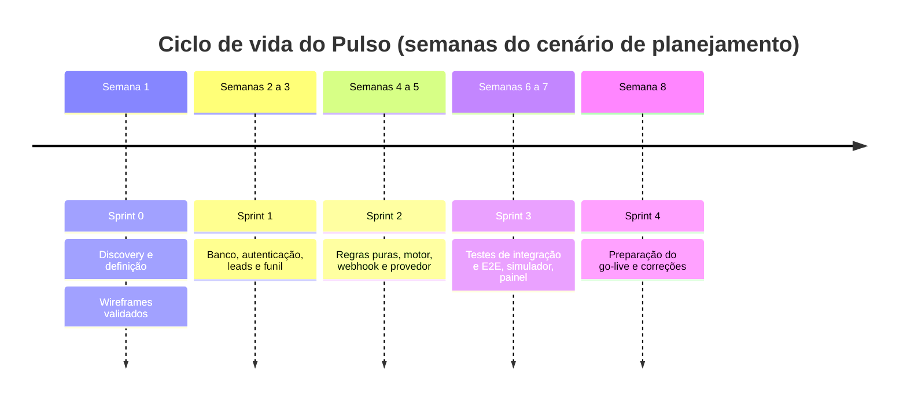
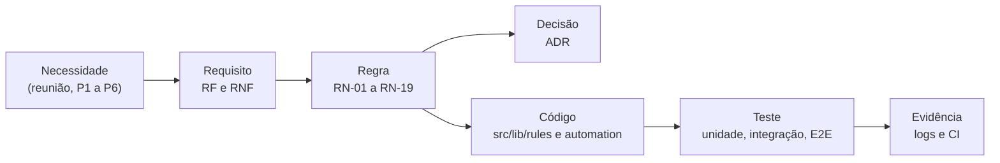
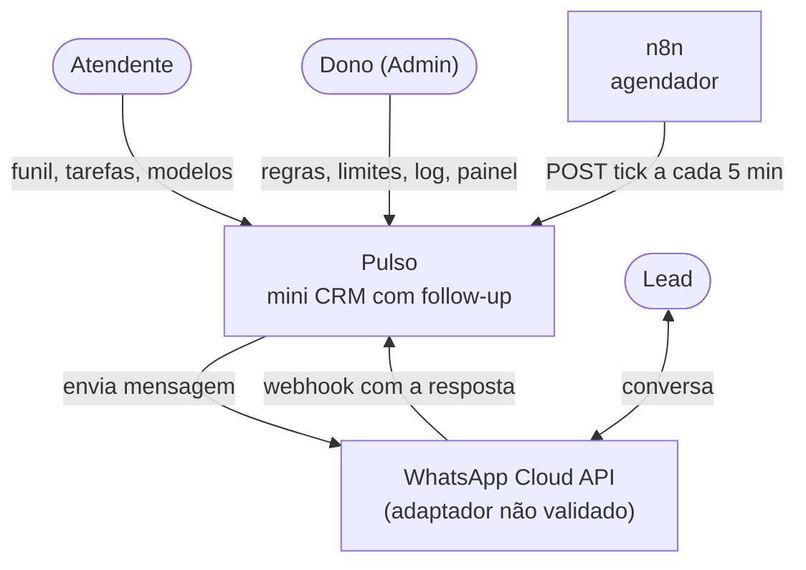
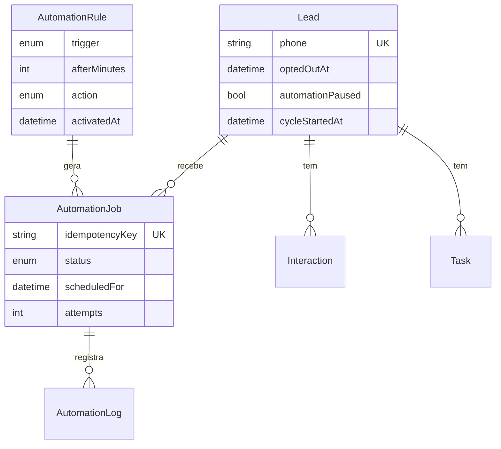
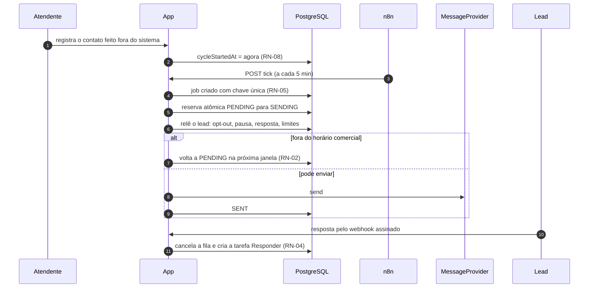

# Pulso

**Mini CRM com funil de vendas e follow-up automático no WhatsApp: regras configuráveis, horário comercial, sem duplicar mensagem, parada na resposta e opt-out.**

Relatório do ciclo de vida de um produto de automação comercial, da descoberta do problema à evolução, com a evidência de cada decisão.

[Problema e solução](#problema-de-negócio-e-solução) · [Demonstração](#demonstração-visual) · [Ciclo de vida](#ciclo-de-vida-do-discovery-à-evolução) · [Scrum](#scrum-e-planejamento-de-sprints) · [Arquitetura](#arquitetura-e-decisões-técnicas) · [Dados](#modelo-de-dados-e-banco) · [Testes](#estratégia-de-testes-e-evidências-de-qualidade) · [Competência → evidência](#competência-demonstrada--evidência-documental) · [Limites](#limitações-riscos-e-evolução-prevista) · [Documentos](#índice-dos-documentos-complementares)

## Proposta de valor

Numa empresa de serviços, o orçamento sai e o retorno depende de alguém lembrar. O Pulso agenda esse retorno e o executa por regras, com quatro travas que protegem o cliente: envio só em horário comercial, nunca a mesma mensagem duas vezes, parada quando o lead responde e respeito ao opt-out. O caso mostra como essas travas foram descobertas com o cliente, especificadas, implementadas e provadas por teste.

## Problema de negócio e solução

Cenário fictício: numa empresa de reformas com 6 pessoas, o lead esfria depois do orçamento. O dono quer "tudo automático", mas teme a mensagem errada em seu nome; a atendente quer mais controle; a cliente-tipo bloqueia quem insiste ou escreve de madrugada.

A solução automatiza dentro de limites explícitos. As regras são configuráveis, cada decisão do motor deixa registro com motivo, e uma regra pode só criar uma tarefa para a atendente em vez de enviar. Fontes: [problemas P1 a P6](docs/01-discovery/07-problemas-priorizados.md) e [visão e metas](docs/02-definicao/01-visao-e-metas.md).

## Demonstração visual

<table>
<tr>
<td width="50%"></td>
<td width="50%"></td>
</tr>
<tr>
<td width="50%"></td>
<td width="50%"></td>
</tr>
</table>

Fluxo real de 23 segundos: contato registrado, follow-up enviado, resposta pelo simulador e parada da sequência. O follow-up só vence em 24 h, então o ciclo rodou com data simulada pelo recurso do próprio projeto; por isso o envio aparece com data posterior à resposta. [Todas as telas, com legenda](docs/imagens/README.md).

## Ficha técnica

| Campo | Informação |
|---|---|
| Natureza | Estudo de caso fictício |
| Stack | Next.js 15, React 19, TypeScript, Prisma, PostgreSQL, Zod, Vitest, Playwright, n8n |
| Testes | 200 de unidade e integração (111 + 89) e 16 E2E; 24/10/2026, commit `cbbcc47` ([logs](docs/05-qualidade/README.md)) |
| CI | Tipos, lint, testes e E2E a cada push na `main` e em PR; [último run](https://github.com/Joaogabrielmaia/Automated-CRM-follow-up-on-WhatsApp/actions/runs/40100951747) verde |

## Principais funcionalidades

- Funil de leads com etapas configuráveis, linha do tempo, tarefas por lead e importação por CSV.
- Quatro garantias: horário comercial (RN-01, RN-02), sem duplicar (RN-05), parada na resposta (RN-04) e opt-out por SAIR, PARAR ou STOP (RN-03).
- Regras com gatilho, espera e ação (enviar, criar tarefa ou mover para Perdido) e modelos de mensagem com variáveis.
- Fila que respeita a janela comercial em UTC−3, retentativa com backoff de 1, 5 e 15 minutos e recuperação de job travado.
- Log de cada decisão do motor, painel de indicadores e simulador de resposta do lead.

## Ciclo de vida: do discovery à evolução

| Fase | O que a documentação mostra | Documento |
|---|---|---|
| Descoberta | Contexto, personas, reuniões, restrições, AS-IS e TO-BE | [01 Visão e discovery](docs/ciclo-de-vida/01-visao-e-discovery.md) |
| Planejamento | Backlog, release plan, sprints, riscos e cerimônias | [02 Planejamento e Scrum](docs/ciclo-de-vida/02-planejamento-e-scrum.md) |
| Requisitos | 20 RF, 9 RNF, 19 RN, 16 HU e rastreabilidade até o teste | [03 Requisitos](docs/ciclo-de-vida/03-requisitos-e-rastreabilidade.md) |
| Arquitetura | C4, sequência, estados, ADRs e atributos de qualidade | [04 Arquitetura](docs/ciclo-de-vida/04-arquitetura-e-adrs.md) |
| Dados | ER, dicionário, restrições e a chave que impede duplicidade | [05 Modelo de dados](docs/ciclo-de-vida/05-modelo-de-dados.md) |
| Desenvolvimento | Branches, PRs, commits, CI e dívida técnica | [06 Desenvolvimento](docs/ciclo-de-vida/06-desenvolvimento-e-configuracao.md) |
| Qualidade | Pirâmide, casos, defeitos e medições | [07 Testes e qualidade](docs/ciclo-de-vida/07-testes-e-qualidade.md) |
| Implantação | Rollout, rollback, treinamento e monitoramento, com status | [08 Implantação e operação](docs/ciclo-de-vida/08-implantacao-e-operacao.md) |
| Evolução | Mudanças, dívida priorizada e roadmap | [09 Evolução e roadmap](docs/ciclo-de-vida/09-evolucao-e-roadmap.md) |

## Linha do tempo e marcos

| Marco | Evidência |
|---|---|
| Discovery e escolha da ideia | [Brainstorm](docs/01-discovery/01-brainstorm-e-escolha.md), commit `8250ab4` |
| Schema, regras puras e motor | commits `9a98212`, `8287eff`, `91b341f` |
| Suítes de integração e E2E | commits `b0f0c57`, `3450f06`, `286f650` |
| Correção do `loading.tsx` | [ADR-010](docs/03-arquitetura/adr/ADR-010-sem-loading-tsx.md), commit `1cb4fd7` |
| CI verde na `main` | [run 39980673278](https://github.com/Joaogabrielmaia/Automated-CRM-follow-up-on-WhatsApp/actions/runs/39980673278), commit `cbbcc47` |

As semanas organizam o cenário de planejamento. Os commits têm data real, entre 22/10/2026 e 24/10/2026 ([tabela](docs/ciclo-de-vida/06-desenvolvimento-e-configuracao.md#linha-do-tempo-real-dos-commits)).

## Scrum e planejamento de sprints

| Sprint | Objetivo | Página |
|---|---|---|
| 0 Discovery e definição | Entender o problema, definir o produto e validar o protótipo | [Sprint 0](docs/ciclo-de-vida/sprints/sprint-0.md) |
| 1 Fundação | Leads e funil com autorização no servidor | [Sprint 1](docs/ciclo-de-vida/sprints/sprint-1.md) |
| 2 Automação | Motor que envia sem incomodar | [Sprint 2](docs/ciclo-de-vida/sprints/sprint-2.md) |
| 3 Qualidade e visibilidade | Provar as garantias com testes e dar visibilidade | [Sprint 3](docs/ciclo-de-vida/sprints/sprint-3.md) |
| 4 Preparação do go-live | Fechar as lacunas do go-live | [Sprint 4](docs/ciclo-de-vida/sprints/sprint-4.md) |

Cada página traz escopo, entregáveis com commits reais, critérios de conclusão, planning, refinamento, review e retrospectiva. O [documento 02](docs/ciclo-de-vida/02-planejamento-e-scrum.md) reúne Product Goal, backlog priorizado, release plan, DoR, DoD e critérios de repriorização. Não há velocity nem burndown: o projeto não tem esses dados.

## Reuniões e decisões com o cliente

| Reunião (simulada) | Decisão que mudou o produto |
|---|---|
| [Dono](docs/01-discovery/03-registro-dono.md) | Automático dentro de limites explícitos; provedor plugável por causa do número dedicado; ação "criar tarefa" |
| [Atendente](docs/01-discovery/04-registro-atendente.md) | Pausa por lead, modelos editáveis e "O que fazer hoje" a dois cliques |
| [Cliente-tipo](docs/01-discovery/05-registro-cliente.md) | Limite de mensagens, horário comercial e opt-out por palavra |
| [Validação do protótipo](docs/04-prototipo/02-validacao-do-prototipo.md) | 10 pedidos: 5 aceitos, 3 adiados, 2 recusados, cada um com motivo |

Índice das atas: [Reuniões](docs/ciclo-de-vida/reunioes/README.md).

## Gestão de requisitos e rastreabilidade

Os requisitos (20 RF, 9 RNF), as 19 regras de negócio e as 16 histórias têm IDs consistentes. A [matriz](docs/02-definicao/07-rastreabilidade.md) liga requisito, história, teste e tela em 25 linhas, e o [documento 03](docs/ciclo-de-vida/03-requisitos-e-rastreabilidade.md) estende a cadeia até o código dos fluxos críticos.

## Arquitetura e decisões técnicas

O app guarda e decide tudo; o n8n só dispara o ciclo. Regra de negócio fica em funções puras que recebem a hora. Contêineres, sequência, estados do lead e atributos de qualidade: [documento 04](docs/ciclo-de-vida/04-arquitetura-e-adrs.md).

| ADR | Decisão |
|---|---|
| [001](docs/03-arquitetura/adr/ADR-001-n8n-ou-jobs-em-codigo.md) | n8n só como agendador; a lógica fica no código |
| [002](docs/03-arquitetura/adr/ADR-002-provedor-de-mensagens.md) | Interface de provedor com adaptador simulado |
| [003](docs/03-arquitetura/adr/ADR-003-idempotencia.md) | Idempotência por chave única no banco e reserva atômica |
| [005](docs/03-arquitetura/adr/ADR-005-retentativa-e-falhas.md) | Backoff de 1, 5 e 15 minutos; erro definitivo não repete |
| [010](docs/03-arquitetura/adr/ADR-010-sem-loading-tsx.md) | Sem `loading.tsx`: defeito que só aparecia no build de produção |

**A decisão difícil: não enviar duas vezes.** Texto de [ADR-003](docs/03-arquitetura/adr/ADR-003-idempotencia.md) e do [registro do dono](docs/01-discovery/03-registro-dono.md).

| | |
|---|---|
| Contexto | O ciclo pode rodar duas vezes seguidas (n8n repetindo a chamada, duas instâncias, execução manual). O dono citou "mandar duas vezes a mesma coisa" como a pior hipótese |
| Alternativas | Consultar "já enviei?" antes de enviar (não resolve execuções simultâneas); lock global do ciclo (serializa tudo e não protege contra repetição em outro momento); chave única por intenção de envio mais reserva atômica |
| Escolha | Duas camadas, ambas no banco: `INSERT ... ON CONFLICT DO NOTHING` sobre a chave regra + lead + ciclo, e `UPDATE ... WHERE status = 'PENDING'` antes de enviar |
| Custo aceito | Se o processo cair entre a reserva e a resposta do provedor, o job vira falha por "estado incerto", sem reenvio, e gera tarefa para a atendente. A mensagem pode não sair; não sai duplicada |
| Quando mudaria | Se o provedor aceitasse chave de idempotência própria, a chave seria repassada e os jobs em estado incerto poderiam ser reenviados com segurança |
| Contexto de escopo | A API oficial exige número dedicado e o dono não quer trocar o dele. Isso levou ao provedor plugável e à ação "criar tarefa" |

## Modelo de dados e banco

O schema tem 13 modelos, 6 enumerações e 3 migrations. A prevenção de duplicidade vive em duas restrições únicas, `AutomationJob.idempotencyKey` e `WebhookEvent.externalId`, mais a reserva atômica por `updateMany` com `status = PENDING`.

ER completo, dicionário de dados, índices, migrations e seeds: [documento 05](docs/ciclo-de-vida/05-modelo-de-dados.md).

## Fluxo principal do sistema

## Estratégia de testes e evidências de qualidade

| Camada | Testes | Evidência |
|---|---|---|
| Unidade | 111 em 10 arquivos | [log](docs/05-qualidade/execucao-test-cbbcc47.txt) |
| Integração, contra PostgreSQL | 89 em 9 arquivos | mesmo log |
| Ponta a ponta, contra o build de produção | 16 em 5 arquivos | [log do E2E](docs/05-qualidade/execucao-test-e2e-cbbcc47.txt) |

Todos passaram em 24/10/2026, no commit `cbbcc47`, e a mesma sequência passou na CI ([runs](docs/ciclo-de-vida/06-desenvolvimento-e-configuracao.md#cicd-e-automações-existentes)). Os casos positivos, negativos, de limite, de falha e de regressão, o registro de seis defeitos com causa raiz e os casos propostos para as lacunas estão no [documento 07](docs/ciclo-de-vida/07-testes-e-qualidade.md).

Medição do defeito do `loading.tsx`: com o arquivo, 3 em 40 (simulador) e 5 em 40 (regras) ações sem atualizar a tela; sem ele, 0 em 60 e 0 em 40. Tabela do autor, resultado bruto não arquivado, de 23/10/2026: [ADR-010](docs/03-arquitetura/adr/ADR-010-sem-loading-tsx.md) e a [interpretação](docs/ciclo-de-vida/07-testes-e-qualidade.md#medições-do-adr-010).

## Implantação, operação e adoção

| Elemento | Situação |
|---|---|
| Execução local, build de produção e E2E | Existe e foi executado |
| Fluxo do n8n versionado | Executado uma vez, sem log arquivado |
| Rollout em fases, rollback, runbook e treinamento | Planejados; nenhum foi ensaiado |
| Hospedagem e envio real pela Meta | Planejados; não existem |

O rollout começa sem envio, só com lembretes para a atendente. Detalhes: [documento 08](docs/ciclo-de-vida/08-implantacao-e-operacao.md), [rollout](docs/06-go-live/rollout.md), [rollback](docs/06-go-live/rollback.md) e [runbook](docs/07-pos-go-live/runbook.md).

## Gestão de configuração e evolução

Branch `main` e branches de trabalho com PR (#1 e #2 mesclados, CI verde antes do merge), Conventional Commits com os IDs de requisito, schema com 3 migrations. O repositório não tem tags, releases nem CHANGELOG. Mudanças, dívida técnica priorizada e roadmap: [documento 06](docs/ciclo-de-vida/06-desenvolvimento-e-configuracao.md) e [documento 09](docs/ciclo-de-vida/09-evolucao-e-roadmap.md).

## Competência demonstrada → evidência documental

| Competência | Evidência |
|---|---|
| Gerenciamento de projetos e Scrum | [Planejamento e Scrum](docs/ciclo-de-vida/02-planejamento-e-scrum.md) e [sprints](docs/ciclo-de-vida/sprints/README.md) |
| Análise de negócios e requisitos | [19 regras de negócio](docs/02-definicao/03-regras-de-negocio.md) e [rastreabilidade](docs/ciclo-de-vida/03-requisitos-e-rastreabilidade.md) |
| Levantamento de necessidades e relacionamento com clientes | [Reuniões](docs/ciclo-de-vida/reunioes/README.md) e [validação do protótipo](docs/04-prototipo/02-validacao-do-prototipo.md): 2 recusados, 3 adiados, 5 aceitos |
| Arquitetura e decisões técnicas | [Arquitetura e ADRs](docs/ciclo-de-vida/04-arquitetura-e-adrs.md) |
| Modelagem de dados e SQL | [Modelo de dados](docs/ciclo-de-vida/05-modelo-de-dados.md): restrições únicas, `ON CONFLICT`, reserva atômica |
| Integração de sistemas | [ADR-002](docs/03-arquitetura/adr/ADR-002-provedor-de-mensagens.md), [ADR-007](docs/03-arquitetura/adr/ADR-007-validacao-do-webhook.md) e [`automations/tick.json`](automations/tick.json) |
| Qualidade, confiabilidade e segurança | [Testes e qualidade](docs/ciclo-de-vida/07-testes-e-qualidade.md) e [ADR-003](docs/03-arquitetura/adr/ADR-003-idempotencia.md) |
| Gerência de configuração e versionamento | [Desenvolvimento e configuração](docs/ciclo-de-vida/06-desenvolvimento-e-configuracao.md) |
| Implantação, treinamento, adoção e suporte | [Implantação e operação](docs/ciclo-de-vida/08-implantacao-e-operacao.md), com o status de cada plano |
| Consultoria de soluções e comunicação de decisões | [ADRs com trade-off](docs/03-arquitetura/README.md) e a decisão difícil acima |
| Monitoramento, indicadores e melhoria contínua | [Painel](docs/imagens/05-painel.png), [health e log](docs/ciclo-de-vida/08-implantacao-e-operacao.md#monitoramento-logs-alertas-e-suporte), [ADR-010](docs/03-arquitetura/adr/ADR-010-sem-loading-tsx.md) e [evolução](docs/ciclo-de-vida/09-evolucao-e-roadmap.md) |

## Limitações, riscos e evolução prevista

- O envio usa um provedor simulado; o adaptador da WhatsApp Cloud API não foi validado contra a Meta.
- O agendamento do n8n rodando por horas não foi testado.
- Rollback, runbook e treinamento são planos; nenhum foi ensaiado.
- Acessibilidade e carga não foram testadas; RNF-05 não tem teste automático.
- As metas M1 a M6 são hipóteses sem medição.

Evolução prevista, por prioridade: validar o adaptador na sandbox da Meta, cadastrar o monitor externo do agendador e criar tags, releases e CHANGELOG ([dívida técnica](docs/ciclo-de-vida/09-evolucao-e-roadmap.md#dívida-técnica-priorizada)).

## Índice dos documentos complementares

[Ciclo de vida](docs/ciclo-de-vida/README.md) · [Sprints](docs/ciclo-de-vida/sprints/README.md) · [Reuniões](docs/ciclo-de-vida/reunioes/README.md) · [Diagramas](docs/ciclo-de-vida/diagramas/README.md) · [Guia da série](docs/INDEX.md) · [Glossário](docs/GLOSSARIO.md) · [Galeria](docs/imagens/README.md) · [Qualidade](docs/05-qualidade/README.md)

## Licença

MIT. O código roda localmente; instruções no arquivo [CONTRIBUTING.md](CONTRIBUTING.md).

## Nota de contexto acadêmico

Este material integra um estudo de caso. A empresa, as pessoas e os dados são fictícios, e as reuniões de discovery e de validação do protótipo são registros simulados, identificados por papel. Cronogramas, sprints e cerimônias foram elaborados para compor o cenário de aprendizagem e não correspondem a datas de commits, releases ou execuções.

A inteligência artificial foi usada na construção do cenário (nos papéis do dono, da atendente e da cliente-tipo dos registros simulados) e na redação e revisão da documentação. Resultados de testes e da CI vêm de execuções reais, com data e commit.
