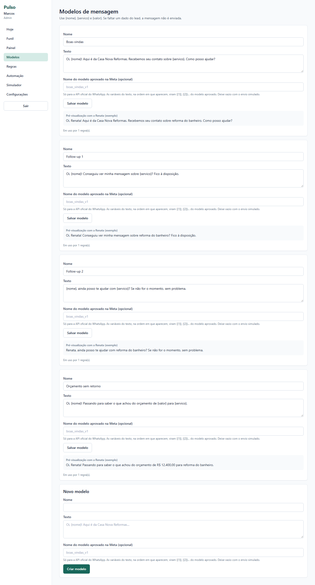
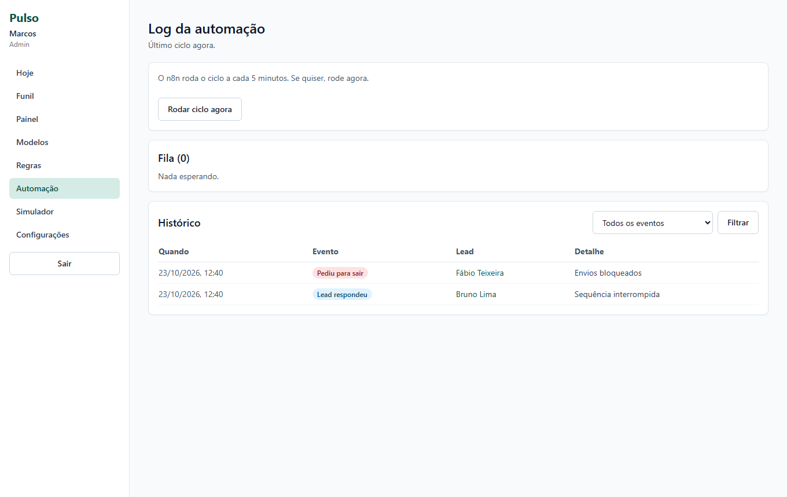
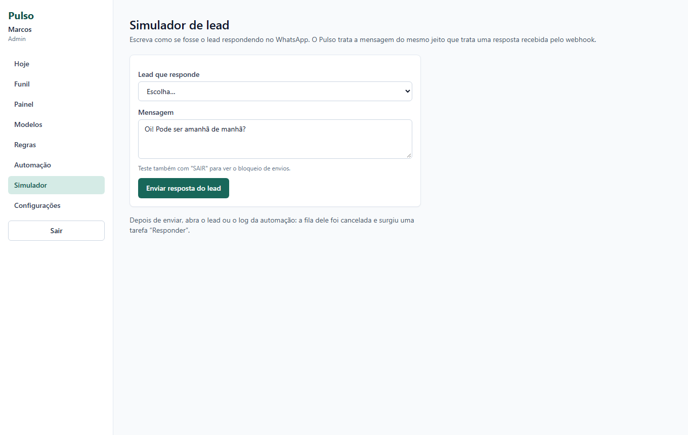
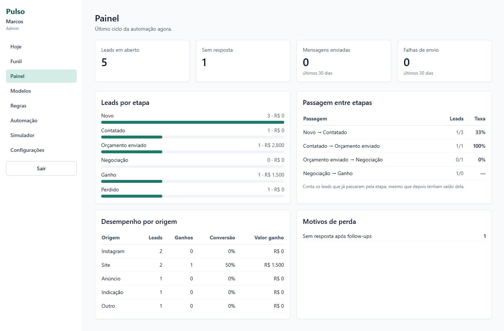
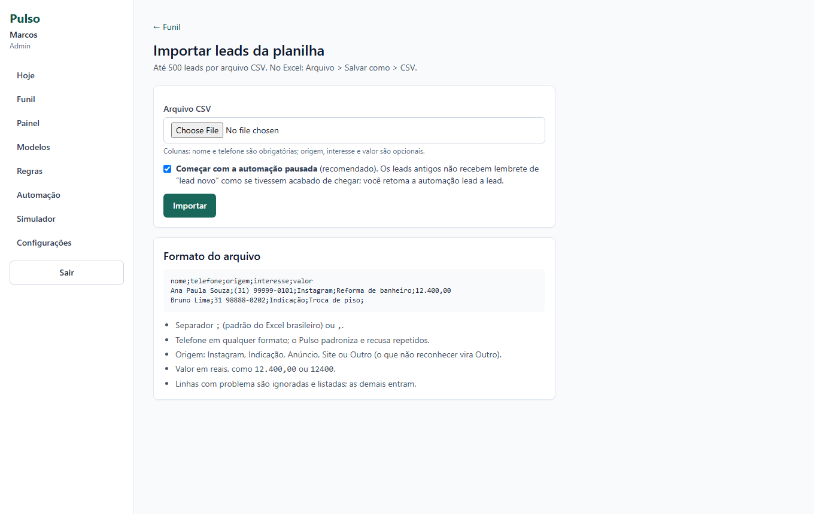
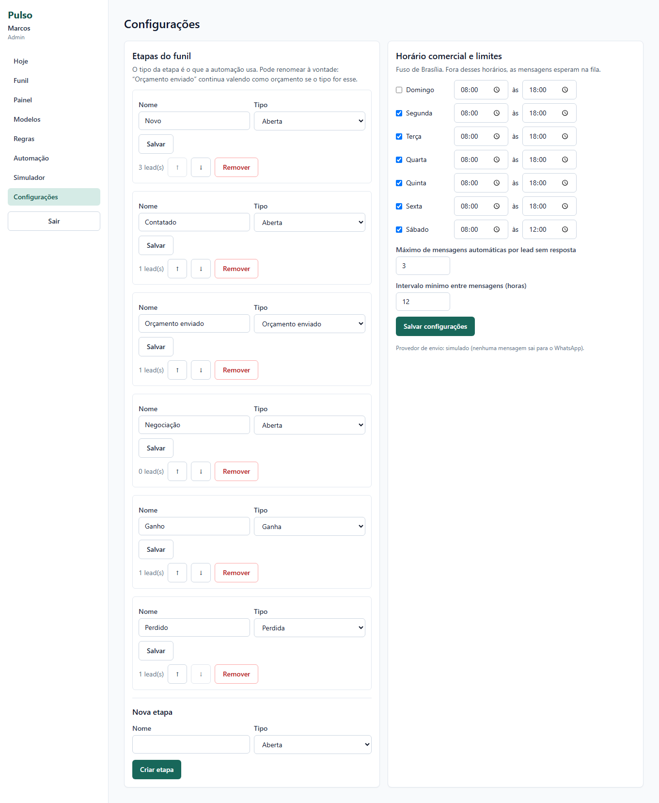
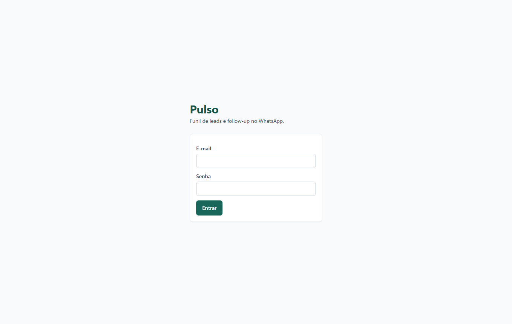

# Pulso

**Mini CRM para pequenas empresas de serviços, com funil de vendas e follow-up automático no WhatsApp.**

O Pulso nasceu de um problema simples: numa empresa pequena, o lead esfria depois do orçamento porque ninguém lembra de voltar a falar com ele na hora certa. Automatizar isso é fácil. O difícil é automatizar **sem incomodar o cliente**. Por isso o projeto é construído em torno de quatro garantias:

- só envia mensagem **em horário comercial** (fora dele, a mensagem espera na fila);
- **nunca manda a mesma mensagem duas vezes**, mesmo com dois ciclos rodando ao mesmo tempo;
- **para na hora em que o lead responde** e avisa a atendente;
- **respeita quem pede para sair** (SAIR, PARAR, STOP) e bloqueia novos envios.

> **Sobre este caso.** A empresa (Casa Nova Reformas), as pessoas e as entrevistas do discovery são **simulados**, e isso está dito no topo de cada registro. Não há usuário real nem WhatsApp real conectado: o envio padrão é simulado. O projeto não está publicado em nenhum servidor; ele roda na sua máquina e o que está aqui é o código, os testes e a documentação.

## Veja o produto

Os prints abaixo foram tirados do app rodando com os dados de demonstração.

### O dia da atendente: tarefas e leads sem resposta


A primeira tela da Camila (atendente) mostra o que fazer hoje: tarefas atrasadas, as do dia e os leads que ainda não responderam. Tarefas como "Responder Bruno" são **criadas pela automação** quando o lead escreve.

### Funil de vendas


Um quadro por etapa (Novo, Contatado, Orçamento enviado, Negociação, Ganho, Perdido). As etapas são configuráveis ([ADR-006](docs/03-arquitetura/adr/ADR-006-etapas-configuraveis.md)). Também há busca, cadastro de lead e importação por CSV.

### Lead: linha do tempo e próximo passo da automação


Tudo o que aconteceu com o lead fica na linha do tempo (notas, mensagens, respostas, mudanças de etapa). Ao lado, o **próximo passo da automação** mostra exatamente quando cada follow-up vai sair, então ninguém precisa adivinhar o que o sistema vai fazer. Dá para pausar a automação só daquele lead e registrar um contato feito fora do sistema (o prazo do follow-up passa a contar desse momento).

### Regras e modelos de mensagem




Cada regra tem um gatilho (lead novo, sem resposta, orçamento parado), uma espera e uma ação: enviar mensagem, criar tarefa ou mover para Perdido. O texto das mensagens fica em modelos editáveis, com variáveis como `{nome}` e `{servico}`. Se faltar um dado que o modelo usa, a mensagem é **pulada** em vez de sair quebrada (RN-14).

### Log da automação



Cada decisão do motor fica registrada: quem respondeu, quem pediu para sair, o que foi enviado, pulado, cancelado ou falhou. É a tela para responder "por que essa mensagem saiu (ou não saiu)?".

### Simulador de resposta



Como não há WhatsApp real, o simulador faz o papel do lead: escreva uma resposta (ou "SAIR") e veja a fila ser cancelada e a tarefa aparecer. A resposta passa pelo mesmo caminho de uma mensagem recebida pelo webhook.

### Outras telas

| Painel de indicadores | Importação por CSV |
|---|---|
|  |  |

| Configurações (horário comercial, limites) | Login |
|---|---|
|  |  |

## Como funciona

```
 n8n (a cada 5 min) ──POST /api/automation/tick──▶  App Next.js ──▶ PostgreSQL
                                                       │
 WhatsApp (resposta do lead) ──webhook──▶ rota do app ─┤
                                                       ▼
                                           MessageProvider
                                      simulated  |  whatsapp-cloud
```

- O **app** (Next.js, Prisma e PostgreSQL) guarda leads, funil, tarefas, regras e o histórico.
- O **n8n** só **dispara** o ciclo a cada 5 minutos. Toda decisão de negócio fica no app, em funções puras testadas. Se o n8n cair, nada se perde: o próximo ciclo recupera o atraso ([por quê](docs/03-arquitetura/adr/ADR-001-n8n-ou-jobs-em-codigo.md)).
- O envio passa sempre por um **`MessageProvider`**: `simulated` (padrão) ou `whatsapp-cloud` (API oficial da Meta, com código e testes, mas **ainda não validado contra a Meta de verdade**).
- Duas respostas ao mesmo tempo ou dois ciclos simultâneos não duplicam mensagem: a garantia é uma **restrição única no banco** ([ADR-003](docs/03-arquitetura/adr/ADR-003-idempotencia.md)).

Fluxo completo da automação: [docs/03-arquitetura/02-fluxo-da-automacao.md](docs/03-arquitetura/02-fluxo-da-automacao.md).

## O que tem em cada pasta

| Pasta | O que tem |
|---|---|
| [`src/app`](src/app) | Telas e rotas do Next.js. As telas ficam em `(app)/` (hoje, funil, lead, regras, modelos, automação, simulador, painel, configurações); as rotas de API em `api/` (ciclo da automação, health e webhooks do WhatsApp) |
| [`src/app/actions`](src/app/actions) | Server actions. Cada uma valida a entrada com Zod e confere sessão e papel no servidor |
| [`src/components`](src/components) | Componentes de interface reutilizáveis |
| [`src/lib/rules`](src/lib/rules) | **Regras de negócio como funções puras** que recebem `now`: horário comercial, opt-out, backoff, limites, telefone, modelo de mensagem, assinatura do webhook, CSV |
| [`src/lib/automation`](src/lib/automation) | Orquestração com banco: o motor do ciclo (`engine.ts`) e o tratamento de respostas recebidas (`inbound.ts`) |
| [`src/lib/providers`](src/lib/providers) | `MessageProvider`: adaptador simulado e adaptador da WhatsApp Cloud API |
| [`src/lib/services`](src/lib/services) | Acesso a dados por assunto (leads, regras, modelos, tarefas, painel, importação, log) |
| [`src/lib/auth`](src/lib/auth) | Sessão, senha (bcrypt) e permissões por papel (Admin e Atendente) |
| [`prisma`](prisma) | Schema, as migrations e os seeds (demonstração e piloto) |
| [`tests`](tests) | Testes unitários (regras puras) e de integração (motor, webhook, permissões, painel, importação) contra um banco de verdade |
| [`e2e`](e2e) | Testes de ponta a ponta no navegador (Playwright), contra o build de produção |
| [`automations`](automations) | O fluxo do n8n versionado (`tick.json`) |
| [`scripts`](scripts) | Utilitários de linha de comando: rodar um ciclo, simular uma resposta, criar um usuário |
| [`docs`](docs) | Toda a documentação do projeto, da ideia ao pós go-live (veja abaixo); os prints deste README ficam em `docs/imagens` |
| [`.github/workflows`](.github/workflows) | CI: tipos, lint, testes e E2E a cada push |

## Documentação

A documentação segue a ordem em que o projeto foi pensado. O ponto de partida é [docs/00-sobre-este-caso](docs/00-sobre-este-caso/README.md).

| Etapa | O que responde | Leia |
|---|---|---|
| **1. Discovery** | Que problema vale resolver e para quem? | [Brainstorm e escolha da ideia](docs/01-discovery/01-brainstorm-e-escolha.md) · [Negócio e personas](docs/01-discovery/02-negocio-e-personas.md) · [Processo atual](docs/01-discovery/06-processo-atual.md) · [Problemas priorizados](docs/01-discovery/07-problemas-priorizados.md) |
| **2. Definição** | O que o produto precisa fazer, e o que fica de fora? | [Visão e metas](docs/02-definicao/01-visao-e-metas.md) · [Requisitos](docs/02-definicao/02-requisitos.md) · [Regras de negócio (RN-01 a RN-19)](docs/02-definicao/03-regras-de-negocio.md) · [Histórias de usuário](docs/02-definicao/04-historias-de-usuario.md) · [Escopo e backlog](docs/02-definicao/05-escopo-e-backlog.md) · [Riscos](docs/02-definicao/06-riscos.md) · [Rastreabilidade](docs/02-definicao/07-rastreabilidade.md) |
| **3. Arquitetura** | Como foi construído, e por quê? | [Modelo de dados](docs/03-arquitetura/01-modelo-de-dados.md) · [Fluxo da automação](docs/03-arquitetura/02-fluxo-da-automacao.md) · [Componentes](docs/03-arquitetura/03-componentes.md) · [Segurança e privacidade](docs/03-arquitetura/04-seguranca-e-privacidade.md) · [Modos de falha](docs/03-arquitetura/05-modos-de-falha.md) |
| **4. Protótipo** | Foi validado antes de codar? | [Wireframes](docs/04-prototipo/01-wireframes.md) · [Validação do protótipo](docs/04-prototipo/02-validacao-do-prototipo.md) |
| **5. Qualidade** | O que está testado, e o que não está? | [Estratégia e resultados](docs/05-qualidade/README.md) |
| **6. Go-live** | Como entraria em uso de verdade? | [Plano de rollout em fases](docs/06-go-live/rollout.md) · [n8n](docs/06-go-live/n8n.md) · [Boas práticas de mensagem](docs/06-go-live/boas-praticas-de-mensagem.md) · [Treinamento](docs/06-go-live/treinamento.md) · [Rollback](docs/06-go-live/rollback.md) |
| **7. Pós go-live** | Como operar e o que aprendi? | [Runbook](docs/07-pos-go-live/runbook.md) · [Retrospectiva](docs/07-pos-go-live/retrospectiva.md) |

### Decisões de arquitetura (ADRs)

Cada decisão importante tem um registro com as alternativas consideradas e o trade-off.

| ADR | Decisão |
|---|---|
| [001](docs/03-arquitetura/adr/ADR-001-n8n-ou-jobs-em-codigo.md) | n8n só como agendador; a lógica fica no código |
| [002](docs/03-arquitetura/adr/ADR-002-provedor-de-mensagens.md) | Interface de provedor com adaptador simulado |
| [003](docs/03-arquitetura/adr/ADR-003-idempotencia.md) | Idempotência por restrição única no banco |
| [004](docs/03-arquitetura/adr/ADR-004-agendamento-e-fila.md) | Agendamento e fila fora do horário comercial |
| [005](docs/03-arquitetura/adr/ADR-005-retentativa-e-falhas.md) | Retentativa com backoff e tratamento de falhas |
| [006](docs/03-arquitetura/adr/ADR-006-etapas-configuraveis.md) | Etapas do funil configuráveis |
| [007](docs/03-arquitetura/adr/ADR-007-validacao-do-webhook.md) | Validação do webhook (HMAC) |
| [008](docs/03-arquitetura/adr/ADR-008-autenticacao.md) | Autenticação e papéis |
| [010](docs/03-arquitetura/adr/ADR-010-sem-loading-tsx.md) | Sem `loading.tsx`: um defeito que só aparecia no build de produção |

## Qualidade

- **200 testes** de unidade e integração (111 + 89) e **16 de ponta a ponta**, em bancos separados.
- Tipos (`tsc`) e lint sem erro; CI configurada em [`.github/workflows/ci.yml`](.github/workflows/ci.yml).
- O E2E roda contra o **build de produção**, não contra o modo de desenvolvimento. Foi assim que apareceu um defeito que o modo dev escondia ([ADR-010](docs/03-arquitetura/adr/ADR-010-sem-loading-tsx.md)).
- O que **não** foi validado está dito com todas as letras em [Qualidade](docs/05-qualidade/README.md): a API da Meta de verdade e o agendamento do n8n rodando por horas.

## Rodar na sua máquina

Precisa de Node 20.9+ e Docker.

```bash
cp .env.example .env        # preencha AUTH_SECRET, AUTOMATION_SECRET e WEBHOOK_SECRET
npm install
npm run db:up               # Postgres na porta 5434
npm run db:migrate
npm run db:seed             # contas de teste e leads fictícios
npm run dev                 # http://localhost:3000
```

Contas de teste (senha `Demo@2026`): `marcos@casanova.example` (Admin) e `camila@casanova.example` (Atendente).

| Comando | O que faz |
|---|---|
| `npm test` | Unitários e integração (precisa do banco no ar) |
| `npm run test:e2e` | Testes no navegador, contra o build de produção |
| `npm run typecheck` / `npm run lint` | Tipos e estilo |
| `npm run tick` | Roda um ciclo da automação na linha de comando |
| `npm run simulate:reply -- <telefone> "<texto>"` | Simula uma resposta de lead |
| `npm run db:seed:pilot` | Etapas, modelos e regras (desligadas) para um piloto real |
| `npm run user:create -- <email> "<Nome>" <ADMIN\|ATTENDANT>` | Cria uma conta real (senha em `PULSO_NEW_PASSWORD`) |

O n8n é opcional e sobe com `docker compose --profile n8n up -d n8n`; o passo a passo está em [docs/06-go-live/n8n.md](docs/06-go-live/n8n.md).

## Licença

MIT.
