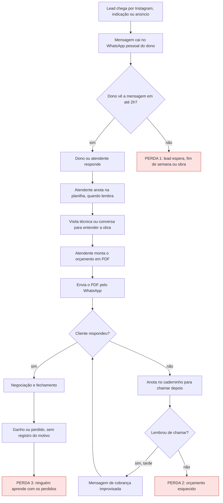

# Processo atual (AS-IS)

**Objetivo:** mostrar como o lead anda hoje e onde ele se perde.
**Data:** 22/10/2026 · **Status:** fechado
**Relacionados:** [problemas priorizados](07-problemas-priorizados.md) · [registro da atendente](04-registro-atendente.md)

Montei este fluxo a partir dos [registros simulados](04-registro-atendente.md). Os blocos em vermelho são onde o lead esfria.

## Onde o lead se perde

| Ponto | O que acontece | Quem sofre |
|---|---|---|
| Perda 1 | Primeira resposta demora, principalmente à noite e fim de semana | Lead e dono |
| Perda 2 | Orçamento enviado e esquecido; o "chamar depois" vive num caderninho | Atendente |
| Perda 3 | Motivo de perda não é anotado, a empresa não aprende | Dono |
| Transversal | Planilha desatualizada, sem origem do lead nem histórico | Todos |
