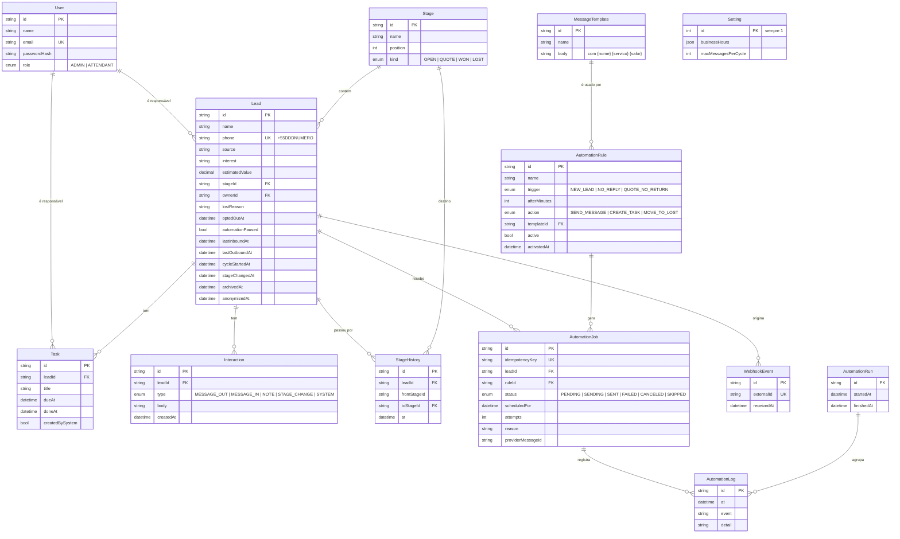

# Modelo de dados

**Objetivo:** mostrar as tabelas do Pulso e como se relacionam.
**Data:** 22/10/2026 · **Status:** vigente (espelha `prisma/schema.prisma`)
**Relacionados:** [ADR-003](adr/ADR-003-idempotencia.md) · [ADR-006](adr/ADR-006-etapas-configuraveis.md)

## Decisões que valem lembrar

- `Lead.phone` é único e já normalizado. O lead arquivado continua ocupando o telefone, para não haver dois históricos do mesmo contato.
- `Lead.cycleStartedAt` guarda o início do ciclo sem resposta ([RN-08](../02-definicao/03-regras-de-negocio.md)). É apagado quando o lead responde.
- `AutomationJob.idempotencyKey` é a garantia de [RN-05](../02-definicao/03-regras-de-negocio.md): regra + lead + instante do ciclo.
- `StageHistory` existe só para o painel calcular a passagem entre etapas sem depender de texto livre.
- Valores em reais ficam em `Decimal(10,2)`, nunca em ponto flutuante.
- Não armazeno CPF, endereço, e-mail do lead nem arquivos. Ver [segurança e privacidade](04-seguranca-e-privacidade.md).
