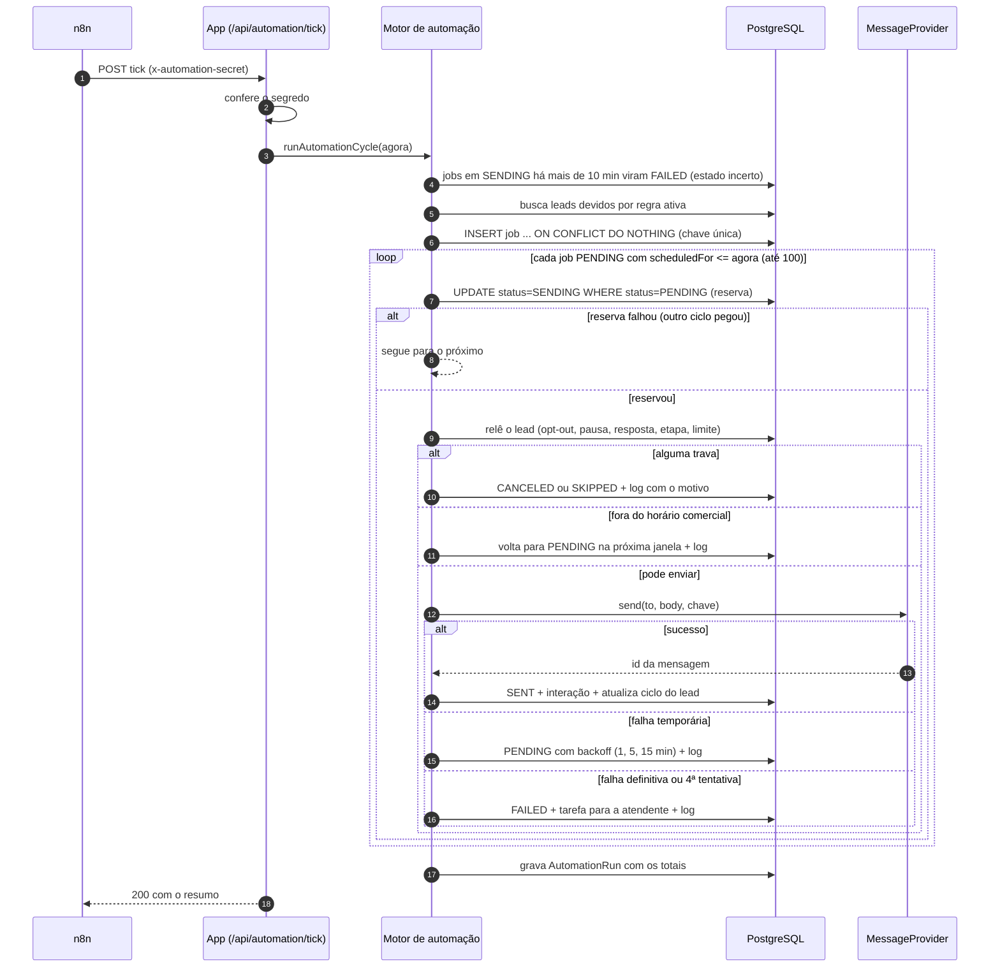
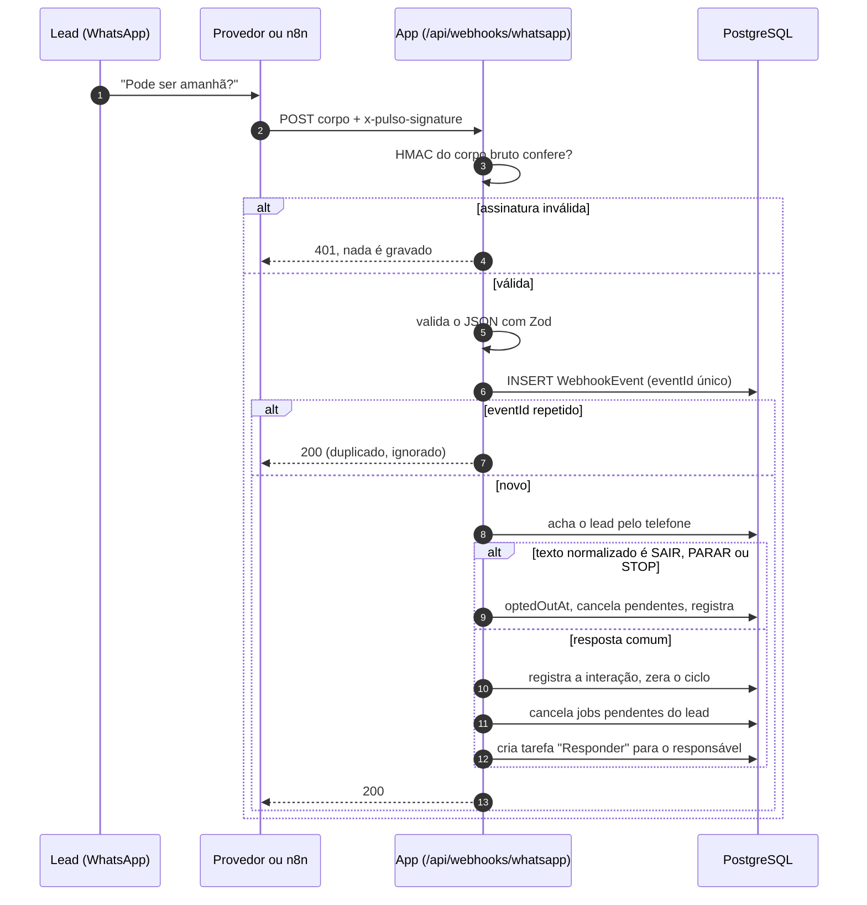
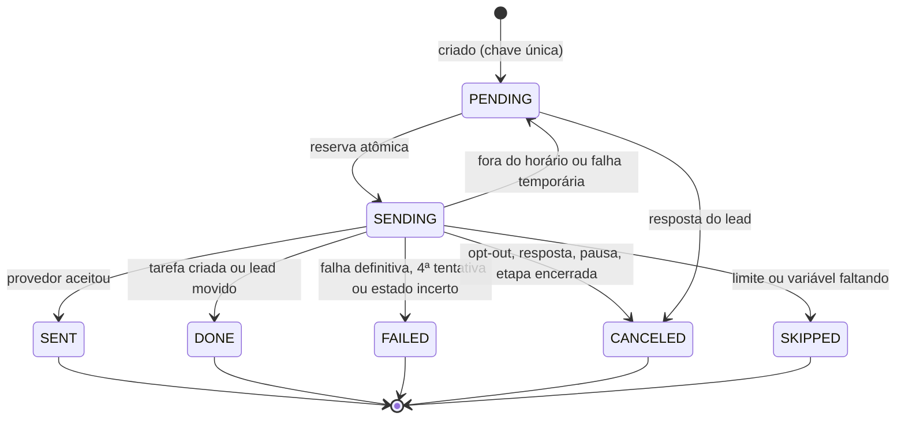

# Fluxo da automação

**Objetivo:** mostrar, passo a passo, o que acontece em um ciclo e quando uma resposta chega.
**Data:** 22/10/2026 · **Status:** vigente
**Relacionados:** [ADR-001](adr/ADR-001-n8n-ou-jobs-em-codigo.md) · [ADR-003](adr/ADR-003-idempotencia.md) · [regras](../02-definicao/03-regras-de-negocio.md)

## Um ciclo (o n8n chama a cada 5 minutos)

## Uma resposta do lead chega

## Estados de um job

