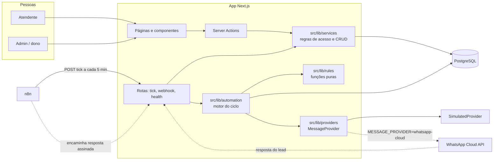

# Diagrama de componentes

**Objetivo:** mostrar as peças do sistema e onde cada responsabilidade mora.
**Data:** 22/10/2026 · **Status:** vigente
**Relacionados:** [ADR-001](adr/ADR-001-n8n-ou-jobs-em-codigo.md) · [ADR-002](adr/ADR-002-provedor-de-mensagens.md)

## Camadas e regra de dependência

- **`rules`**: funções puras (horário comercial, opt-out, modelo, backoff, assinatura, telefone, "o que está devido"). Não importam banco nem relógio.
- **`automation`** e **`services`**: usam o banco e as funções puras. Todo serviço recebe o `actor` e confere permissão.
- **Actions e rotas**: só leem a sessão, validam com Zod e chamam um serviço. Nenhuma regra de negócio mora aqui.
- **`providers`**: o único lugar que conhece o WhatsApp.
