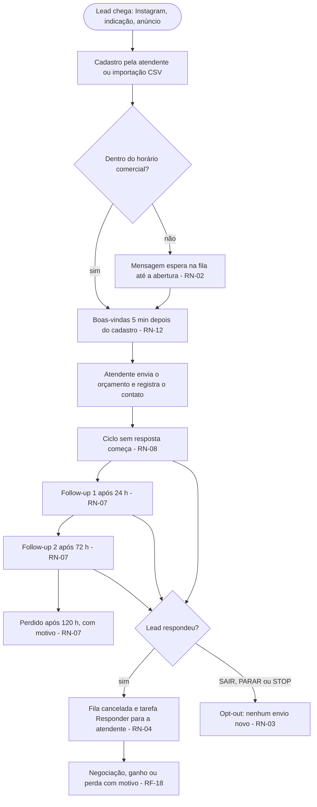

# 01 · Visão e discovery

[← Índice do ciclo de vida](README.md) · Próximo: [02 Planejamento e Scrum →](02-planejamento-e-scrum.md)

## Contexto de negócio

A Casa Nova Reformas (empresa fictícia, 6 pessoas) recebe leads por Instagram, indicação e anúncios, atende pelo WhatsApp pessoal do dono, envia orçamento em PDF e controla tudo numa planilha. O lead esfria depois do orçamento: o retorno depende de alguém lembrar. Fontes: [negócio e personas](../01-discovery/02-negocio-e-personas.md) e [processo atual](../01-discovery/06-processo-atual.md).

## Problema, proposta de valor e visão

| Item | Definição | Fonte |
|---|---|---|
| Problema central | Orçamento enviado e esquecido (P1); lead novo espera mais de 2 h fora do horário (P2); medo de a automação irritar o cliente (P3) | [Problemas priorizados](../01-discovery/07-problemas-priorizados.md) |
| Proposta de valor | Retomar o contato por regras configuráveis, com quatro travas: horário comercial, sem duplicar, parada na resposta e opt-out | [Visão e metas](../02-definicao/01-visao-e-metas.md) |
| Condição de sucesso | A automação não pode piorar a situação atual: P3 é condição para resolver P1 e P2 | [Problemas priorizados](../01-discovery/07-problemas-priorizados.md) |

## Fluxo comercial: AS-IS e TO-BE

O AS-IS está em [Processo atual](../01-discovery/06-processo-atual.md) (três pontos de perda: resposta lenta, orçamento esquecido e motivo de perda sem registro). O TO-BE abaixo mostra o fluxo comercial implementado, com os IDs das regras.

## Partes interessadas

| Parte | Papel no cenário | Interesse | Influência |
|---|---|---|---|
| Dono (Admin) | Decide regras, limites e o que sai em seu nome | Recuperar orçamentos sem perder o controle | Alta |
| Atendente | Opera o funil, os modelos e as tarefas | Saber quem chamar hoje, poder pausar um lead | Alta |
| Mestre de obras | Usuário eventual, no celular | Ver a visita do dia, registrar observações | Baixa |
| Cliente-tipo (lead) | Recebe as mensagens | Não ser pressionado nem receber de madrugada | Média (pode bloquear o número) |
| Provedor de mensagens (Meta) | Dependência externa | Política de modelos e número dedicado | Alta (restringe o escopo) |

Personas detalhadas: [negócio e personas](../01-discovery/02-negocio-e-personas.md).

## Reuniões e decisões com o cliente

As reuniões são registros simulados do cenário, identificados por papel. O índice completo está em [Reuniões](reunioes/README.md). Decisões que mudaram o produto:

| Reunião | Descoberta | Decisão |
|---|---|---|
| [Dono](../01-discovery/03-registro-dono.md) | Quer "tudo automático", mas teme a mensagem errada em seu nome | Automático dentro de limites explícitos, com log e a opção de só lembrar a atendente |
| [Dono](../01-discovery/03-registro-dono.md) | A API oficial exige número dedicado e ele não quer trocar o dele | Interface `MessageProvider` com provedor simulado e ação "criar tarefa" ([ADR-002](../03-arquitetura/adr/ADR-002-provedor-de-mensagens.md), RN-16) |
| [Atendente](../01-discovery/04-registro-atendente.md) | Quer mais controle, não menos | Modelos editáveis, pausa por lead (RF-12) e "O que fazer hoje" a dois cliques (RNF-05) |
| [Cliente-tipo](../01-discovery/05-registro-cliente.md) | Frequência pesa mais que o texto; madrugada afasta; quer responder "para" | No máximo 3 mensagens por ciclo (RN-06), horário comercial (RN-01), opt-out por palavra (RN-03) |

## Escopo e fora de escopo

Dentro: funil com etapas configuráveis, histórico, tarefas, modelos, regras, motor com as quatro garantias, webhook assinado, log, simulador, painel e importação CSV. Fora: multiempresa, mídia e áudio, chatbot com IA, integração com ERP, assinatura digital, cobrança e arrastar e soltar. Detalhe e motivos: [escopo e backlog](../02-definicao/05-escopo-e-backlog.md).

## Restrições, premissas, dependências e riscos iniciais

| Tipo | Item |
|---|---|
| Negócio | Equipe pequena e sem tempo; receio de parecer robô |
| Técnica | Número pessoal do dono não serve para a API oficial; modelos aprovados fora da janela de 24 h (RSK-08) |
| Financeira | Orçamento baixo: sem ferramenta cara por usuário ou por mensagem |
| Operacional | O agendador (n8n) é uma peça a mais para operar (RSK-04) |
| Premissa | Os números do cenário (por exemplo, cerca de 60 pedidos por mês) são hipóteses, não medições |
| Dependência | Conta e número verificados na Meta para qualquer envio real |

Os 10 riscos, com probabilidade, impacto e mitigação, estão em [Riscos](../02-definicao/06-riscos.md).

## Critérios de sucesso e indicadores

As metas M1 a M6 são hipóteses sem medição, porque não houve uso real. Os indicadores que o sistema já registra servem de base: tempo até a primeira mensagem (M1), orçamentos sem ação em 48 h (M2), duplicidade e envio fora do horário (M3), leads perdidos com motivo (M5) e acessos diários (M6). A M4 (15% de resposta) depende do comportamento do lead. Detalhe: [Visão e metas](../02-definicao/01-visao-e-metas.md).

## Evidências

[Brainstorm e matriz de decisão](../01-discovery/01-brainstorm-e-escolha.md) (cinco ideias, CRM com 15 de 20 pontos), [atas](reunioes/README.md), [processo atual](../01-discovery/06-processo-atual.md), [problemas P1 a P6](../01-discovery/07-problemas-priorizados.md).
