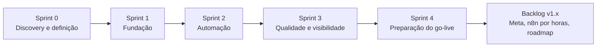

# 02 · Planejamento e Scrum

[← Índice do ciclo de vida](README.md) · [← 01 Visão e discovery](01-visao-e-discovery.md) · Próximo: [03 Requisitos →](03-requisitos-e-rastreabilidade.md)

O planejamento abaixo organiza o desenvolvimento em cinco sprints, em semanas do cenário. É um artefato de planejamento do estudo de caso: as semanas não são datas de commits. O vínculo com o histórico real é feito por hash de commit em cada página de sprint.

## Papéis Scrum

| Papel | Responsabilidade | Observação |
|---|---|---|
| Product Owner (papel) | Prioriza o backlog e aceita as entregas | No cenário, representa o dono e a atendente |
| Scrum Master (papel) | Remove impedimentos e garante as cerimônias | Papéis acumulados numa única pessoa no estudo |
| Time de desenvolvimento (papel) | Entrega o incremento com testes | O mesmo |

## Product Goal

Retomar os leads que esfriam depois do orçamento com um follow-up automático que nunca incomoda o cliente: só em horário comercial, sem duplicar mensagem, parando na resposta e respeitando o opt-out.

## Product Backlog priorizado

Priorização MoSCoW, com os critérios completos em [Escopo e backlog](../02-definicao/05-escopo-e-backlog.md).

| Prioridade | Item | História | Sprint | Justificativa da ordem |
|---|---|---|---|---|
| 1 | Login com papéis | HU-01 | 1 | Base de toda autorização (RNF-03) |
| 2 | Cadastro, funil e etapas | HU-02, 03, 04 | 1 | Sem lead não há o que automatizar |
| 3 | Histórico e tarefas | HU-05 | 1 | A parada na resposta cria tarefa |
| 4 | Modelos e regras | HU-06, 07 | 2 | Configuração antes do motor |
| 5 | Boas-vindas e follow-ups, com as quatro garantias | HU-08, 09, 10, 11 | 2 | É o valor central e a condição P3 |
| 6 | Orçamento sem retorno, pausa por lead, falha do provedor | HU-12, 13, 16 | 2 | Complementam o motor |
| 7 | Painel, log e simulador | HU-14, 15 | 3 | Visibilidade e demonstração |
| 8 | Testes de integração e E2E, CI | transversal | 3 | Prova das garantias |
| 9 | Preparação do go-live: usuário real, importação CSV, desativar regra com fila, health do agendador, webhook nativo da Meta | RF-19, RF-20, RN-19 | 4 | Lacunas reveladas ao descrever a implantação |
| 10 | Arrastar e soltar, previsão de receita, alerta por WhatsApp | pedidos 1, 8, 9 | Roadmap | Adiados na [validação do protótipo](../04-prototipo/02-validacao-do-prototipo.md) |

## Release plan

| Release (plano) | Conteúdo | Critério de saída |
|---|---|---|
| v1.0 MVP | Sprints 1 a 3: funil, motor com as quatro garantias, painel, log, simulador | Suítes de unidade, integração e E2E passando |
| v1.1 Go-live em modo lembrete | Sprint 4: usuário real, importação, seed de piloto, correção da desativação de regra | Rollout fases 0 e 1 ([rollout](../06-go-live/rollout.md)) |
| v1.2 Envio real | Validação do adaptador na sandbox da Meta e agendamento do n8n por horas | Rollout fases 2 e 3 |
| v1.x | Itens do roadmap | Repriorização do backlog |

O repositório não tem tags nem releases publicadas; o plano acima é planejamento. O histórico real está em [Desenvolvimento e configuração](06-desenvolvimento-e-configuracao.md).

## Plano de sprints

| Sprint | Semanas (cenário) | Objetivo | Página |
|---|---|---|---|
| 0 | 1 | Entender o problema, definir o produto e validar o protótipo | [Sprint 0](sprints/sprint-0.md) |
| 1 | 2 e 3 | Ter leads e funil funcionando com autorização no servidor | [Sprint 1](sprints/sprint-1.md) |
| 2 | 4 e 5 | Entregar o motor que envia sem incomodar | [Sprint 2](sprints/sprint-2.md) |
| 3 | 6 e 7 | Provar as garantias com testes e dar visibilidade | [Sprint 3](sprints/sprint-3.md) |
| 4 | 8 | Fechar as lacunas do go-live | [Sprint 4](sprints/sprint-4.md) |

## Definition of Ready e Definition of Done

**Ready:** critérios Dado/Quando/Então, requisitos e regras ligados, tela identificada e nenhuma decisão aberta.

**Done:** critérios atendidos com teste para cada regra de negócio; validação com Zod e papel conferido no servidor; estados de carregamento, vazio e erro; tipos e lint sem erro; CI verde; documentação e rastreabilidade atualizadas; commit em Conventional Commits citando os IDs. Fonte: [escopo e backlog](../02-definicao/05-escopo-e-backlog.md).

## Cerimônias

| Cerimônia | Quando | Resultado esperado |
|---|---|---|
| Planning | Início da sprint | Objetivo, histórias e critérios de conclusão |
| Refinamento | Meio da sprint | Histórias do próximo ciclo com critérios Dado/Quando/Então |
| Review | Fim da sprint | Incremento demonstrado, com a evidência (commit, teste ou tela) |
| Retrospectiva | Fim da sprint | Ações de melhoria, ligadas a defeitos ou riscos registrados |

Cada [página de sprint](sprints/README.md) traz planning, refinamento, review e retrospectiva.

## Gestão de riscos, impedimentos e dependências

| Tema | Tratamento |
|---|---|
| Riscos | Lista viva em [Riscos](../02-definicao/06-riscos.md); RSK-02, 03 e 04 reavaliados na [retrospectiva](../07-pos-go-live/retrospectiva.md) |
| Impedimento: número dedicado | Resolvido por escopo: provedor plugável e ação "criar tarefa" |
| Impedimento: Meta | Segue aberto; o rollout começa sem envio |
| Dependência externa | Conta, número e modelos aprovados na Meta |
| Mudanças | Pedidos da validação do protótipo: 5 aceitos, 3 adiados, 2 recusados, cada um com motivo |

## Critérios de repriorização do backlog

1. Qualquer item que enfraqueça uma das quatro garantias sobe para o topo.
2. Item que depende de conta externa (Meta) não bloqueia o que pode ser entregue sem ela.
3. Pedido de mudança entra pelo mesmo critério de [validação do protótipo](../04-prototipo/02-validacao-do-prototipo.md): custo no escopo, motivo e alternativa.
4. Defeito encontrado na operação entra na sprint seguinte com teste de regressão.

## Indicadores de fluxo e entrega

O projeto não tem dados de tempo de ciclo, velocity nem burndown, e este relatório não os apresenta. O que existe como dado observado é a contagem de commits por tema em cada sprint e a data real de cada um (documento 06).
