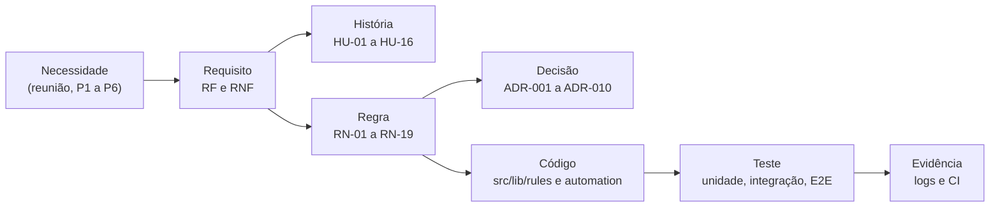

# 03 · Requisitos e rastreabilidade

[← Índice do ciclo de vida](README.md) · [← 02 Planejamento e Scrum](02-planejamento-e-scrum.md) · Próximo: [04 Arquitetura e ADRs →](04-arquitetura-e-adrs.md)

## Do pedido ao requisito

Os requisitos estão em [Requisitos](../02-definicao/02-requisitos.md) (20 RF e 9 RNF, com origem em P1 a P6 ou nas reuniões), as regras em [Regras de negócio](../02-definicao/03-regras-de-negocio.md) (19 RN com valor padrão), as histórias em [Histórias de usuário](../02-definicao/04-historias-de-usuario.md) (16 HU com critérios Dado/Quando/Então) e a priorização MoSCoW em [Escopo e backlog](../02-definicao/05-escopo-e-backlog.md).

| Necessidade (reunião) | Problema | Requisito | Regra | História |
|---|---|---|---|---|
| Mensagem à noite ou de madrugada incomoda (cliente-tipo, dono) | P3 | RF-09 | RN-01, RN-02 | HU-08 |
| Mensagem duplicada é a pior hipótese (dono) | P3 | RNF-01 | RN-05 | HU-09 |
| Limite de duas mensagens sem resposta (dono) | P3 | RF-10 | RN-06, RN-07 | HU-09 |
| Continuar enviando depois da resposta é inaceitável (cliente-tipo) | P3 | RF-13 | RN-04 | HU-10 |
| Poder responder "para" e sair (cliente-tipo) | P3 | RF-14 | RN-03 | HU-11 |
| O orçamento enviado e esquecido (dono, atendente) | P1 | RF-11 | RN-15 | HU-12 |
| Poder pausar um cliente (atendente) | P3 | RF-12 | RN-10 | HU-13 |
| Número pessoal do dono não serve à API oficial (dono) | — | RF-08 (ação "criar tarefa"), ADR-002 | RN-16 | HU-07 |
| Motivo de perda não registrado | P5 | RF-18 | RN-09 | HU-03 |

## Priorização MoSCoW

Must: login, leads, mensagens, regras e as quatro garantias (RN-01 a RN-06, RN-11, RN-14), webhook e opt-out. Should: tarefas, pausa, painel, log, simulador e as demais regras. Could e fora de escopo: arrastar e soltar, multiempresa, chatbot. Justificativas por item: [Escopo e backlog](../02-definicao/05-escopo-e-backlog.md).

## Partes interessadas e RACI

R responsável, A aprova, C consultado, I informado. Papéis do cenário.

| Atividade | Dono (Admin) | Atendente | Responsável pelo produto | Operação |
|---|---|---|---|---|
| Definir limites e regras de envio | A | C | R | I |
| Escrever e aprovar modelos de mensagem | A | R | C | I |
| Pausar um lead | I | R | I | I |
| Remover opt-out | R, A | I | I | I |
| Disparar e monitorar o ciclo (n8n) | I | I | C | R, A |
| Treinamento | I | I | R | C |

## Fluxos e casos de uso principais

Os fluxos têm diagramas de sequência em [Fluxo da automação](../03-arquitetura/02-fluxo-da-automacao.md) e estados em [Arquitetura e ADRs](04-arquitetura-e-adrs.md#estados-do-lead). Casos de uso do cenário:

| Caso de uso | Ator | Resultado | História |
|---|---|---|---|
| Cadastrar ou importar lead | Atendente | Lead em etapa aberta, telefone único | HU-02 |
| Registrar contato fora do sistema | Atendente | Ciclo "sem resposta" começa | HU-05 |
| Receber follow-up automático | Lead | Mensagem em horário comercial, no máximo 3 por ciclo | HU-08, HU-09 |
| Responder ao follow-up | Lead | Fila cancelada, tarefa "Responder" para a atendente | HU-10 |
| Pedir para sair | Lead | Opt-out, nenhum envio novo | HU-11 |
| Ativar ou desativar regra | Dono | Fila da regra cancelada ao desativar (RN-19) | HU-07 |

## Critérios de aceite dos principais fluxos

| Fluxo | Critério de aceite | Teste |
|---|---|---|
| Janela comercial | Mensagem criada à noite espera e sai na abertura seguinte | `tests/integration/engine.test.ts` ("horário comercial") |
| Sem duplicar | Rodar o ciclo duas vezes, ou dois ao mesmo tempo, envia uma vez | `tests/integration/engine.test.ts` ("idempotência", "dois ciclos simultâneos") |
| Parada na resposta | Resposta cancela a fila e cria uma única tarefa | `tests/integration/webhook.test.ts` |
| Opt-out | SAIR, com acento, caixa ou pontuação, bloqueia todos os envios | `tests/integration/webhook.test.ts`, `tests/unit/opt-out.test.ts` |
| Follow-ups | 24 h, 72 h e Perdido em 120 h, com limite de 3 mensagens | `tests/integration/engine.test.ts` ("sequência sem resposta") |

## Rastreabilidade ponta a ponta

A matriz completa, com 25 linhas (requisito → história → teste → tela), está em [Rastreabilidade](../02-definicao/07-rastreabilidade.md). A tabela abaixo estende a cadeia até o código para os fluxos críticos.

| Regra | Código | Teste |
|---|---|---|
| RN-01, RN-02 janela comercial | `src/lib/rules/business-hours.ts`, `src/lib/rules/guards.ts` (reagenda `OFF_HOURS`) | `tests/unit/business-hours.test.ts`, `tests/integration/engine.test.ts` |
| RN-05 sem duplicar | `src/lib/rules/due-rules.ts` (`idempotencyKey`), `prisma/schema.prisma` (`idempotencyKey @unique`), `src/lib/automation/engine.ts` (`createMany` com `skipDuplicates`, reserva `updateMany`) | `tests/integration/engine.test.ts` |
| RN-04 parada na resposta | `src/lib/automation/inbound.ts`, `src/lib/rules/guards.ts` (`REPLIED`) | `tests/integration/webhook.test.ts`, `e2e/simulador.spec.ts` |
| RN-03 opt-out | `src/lib/rules/opt-out.ts`, `src/lib/automation/inbound.ts` | `tests/unit/opt-out.test.ts`, `tests/integration/webhook.test.ts`, `e2e/simulador.spec.ts` |
| RN-06, RN-18 limites | `src/lib/rules/guards.ts` (`LIMIT_REACHED`, `MIN_GAP`) | `tests/unit/guards.test.ts`, `tests/integration/engine.test.ts` |
| RN-07, RN-08 sequência | `src/lib/rules/due-rules.ts` (`computeDue`) | `tests/unit/due-rules.test.ts`, `tests/integration/engine.test.ts` |
| RN-11 retentativa | `src/lib/rules/backoff.ts`, `src/lib/automation/engine.ts` | `tests/unit/backoff.test.ts`, `tests/integration/engine.test.ts` |
| RN-17 regra nova não age sobre o passado | `src/lib/rules/due-rules.ts` (`activatedAt`) | `tests/integration/engine.test.ts` |
| RN-19 desativar cancela a fila | `src/lib/rules/guards.ts` (`RULE_INACTIVE`) | `tests/unit/guards.test.ts`, `tests/integration/engine.test.ts` |
| RNF-09 webhook seguro | `src/lib/rules/signature.ts`, `src/app/api/webhooks/` | `tests/unit/signature.test.ts`, `tests/integration/webhook.test.ts`, `tests/integration/webhook-meta.test.ts` |

## Registro de mudanças

Pedidos de mudança do cenário e sua decisão: [Validação do protótipo](../04-prototipo/02-validacao-do-prototipo.md) (5 aceitos, 3 adiados, 2 recusados). Mudanças de regra durante o desenvolvimento: RN-18 (intervalo mínimo, Sprint 2) e RN-19 (desativar cancela a fila, Sprint 4, commit `d654fab`).
