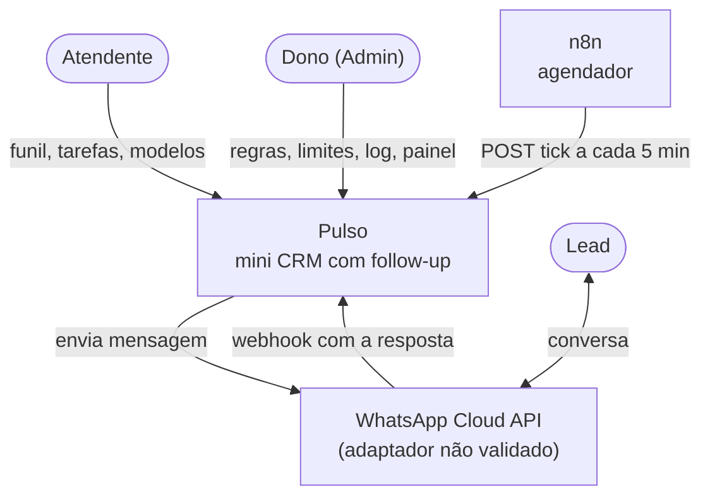
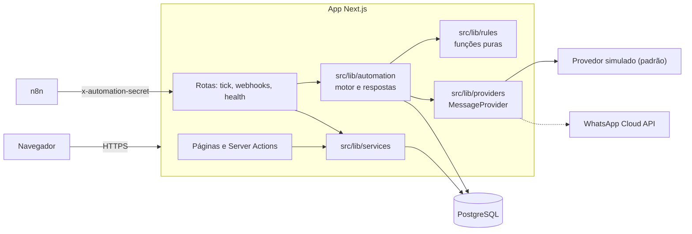
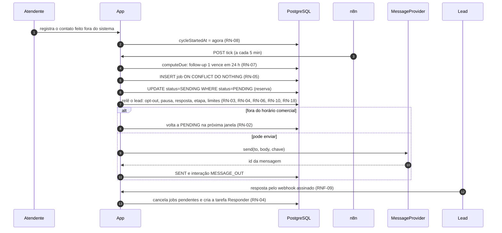
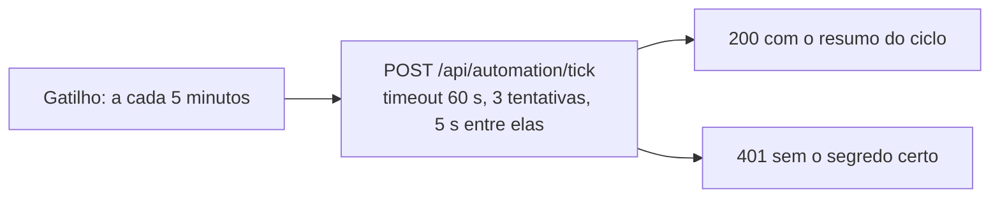
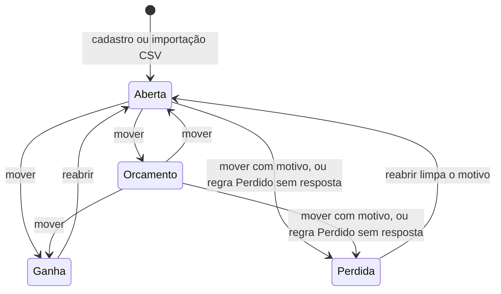
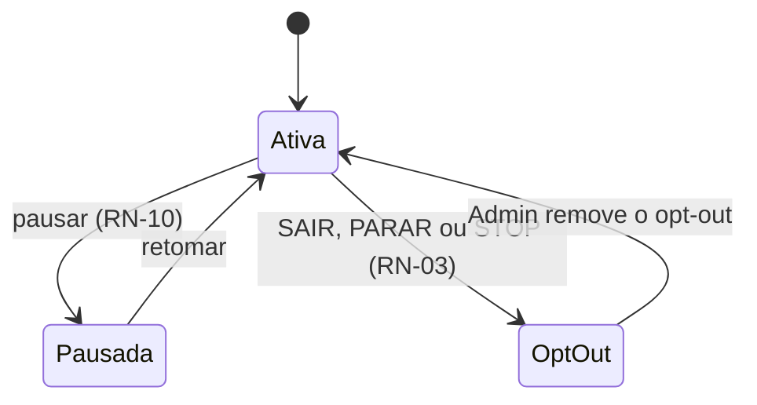
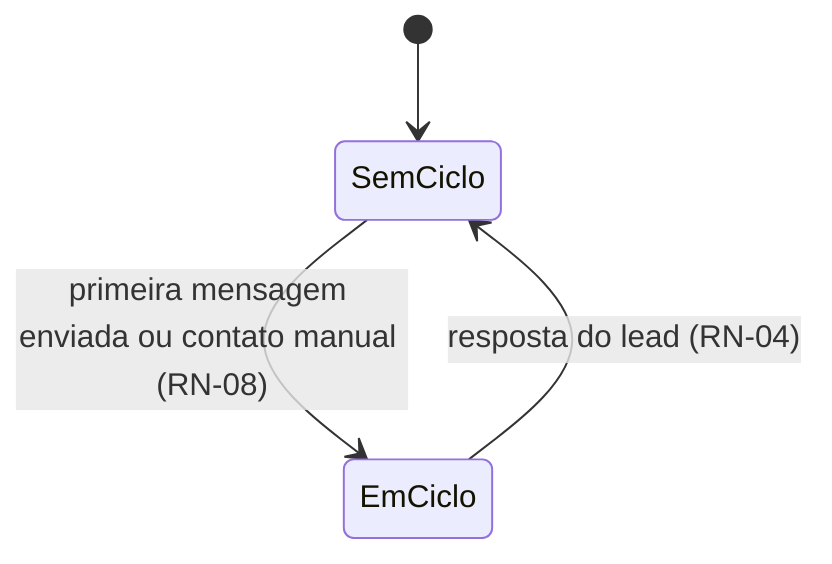
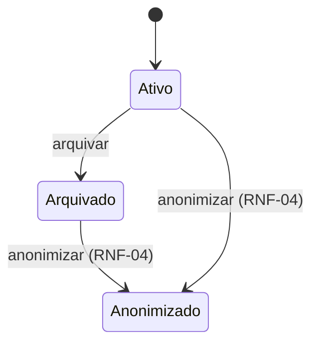

# 04 · Arquitetura e ADRs

[← Índice do ciclo de vida](README.md) · [← 03 Requisitos](03-requisitos-e-rastreabilidade.md) · Próximo: [05 Modelo de dados →](05-modelo-de-dados.md)

Os diagramas representam o código atual (`src/`, `prisma/`, `automations/`). Os documentos de origem ficam em [Episódio 3](../03-arquitetura/README.md).

## Contexto (C4, nível 1)

## Contêineres (C4, nível 2)

Componentes e regra de dependência: [Diagrama de componentes](../03-arquitetura/03-componentes.md). Regra de negócio fica em `rules` e `automation`, nunca em componente ou rota.

## Fluxo de disparo, janela comercial e parada na resposta

Sequência de um follow-up desde o contato da atendente até a parada na resposta, com as regras que decidem cada passo.

Outros diagramas de sequência: [ciclo e resposta do lead](../03-arquitetura/02-fluxo-da-automacao.md).

## Fluxo do agendador (n8n)

Fonte: `automations/tick.json`. O fluxo vem desativado e foi importado e executado uma vez num n8n em Docker (relato do autor, sem log arquivado); o agendamento por horas não foi testado ([n8n](../06-go-live/n8n.md)).

## Estados do lead

O lead não tem um campo de status único. Os estados vêm da etapa (`Stage.kind`), de campos do próprio lead (automação, ciclo) e do registro (arquivado, anonimizado), e são independentes entre si. O primeiro diagrama mostra os movimentos habituais entre etapas; o serviço `moveLead` aceita qualquer etapa como destino.

Correspondência com o código: `StageKind` (`OPEN`, `QUOTE`, `WON`, `LOST`) e `applyStageChange` em `src/lib/domain/shared.ts`; `automationPaused`, `optedOutAt`, `cycleStartedAt`, `lastInboundAt` no `Lead`; `moveLead`, `setPaused`, `removeOptOut`, `archiveLead` e `anonymizeLead` em `src/lib/services/leads.ts`. Entrar em etapa ganha ou perdida cancela os envios pendentes; estados do job: [Fluxo da automação](../03-arquitetura/02-fluxo-da-automacao.md#estados-de-um-job).

## Decisões arquiteturais (ADRs)

Cada ADR traz contexto, alternativas, escolha, trade-off e "quando eu mudaria". Não existe ADR-009; a numeração segue de 008 para 010.

| ADR | Decisão | Consequência aceita |
|---|---|---|
| [001](../03-arquitetura/adr/ADR-001-n8n-ou-jobs-em-codigo.md) | n8n só como agendador; regra no código | Duas peças para operar; se o n8n cair nenhum ciclo roda, e o próximo recupera o atraso |
| [002](../03-arquitetura/adr/ADR-002-provedor-de-mensagens.md) | Interface `MessageProvider`, adaptador simulado e da Cloud API | O adaptador da Meta nunca falou com a API real |
| [003](../03-arquitetura/adr/ADR-003-idempotencia.md) | Chave única mais reserva atômica | No pior instante a mensagem pode não sair; não sai duplicada |
| [004](../03-arquitetura/adr/ADR-004-agendamento-e-fila.md) | Fila que espera a janela comercial, fuso fixo UTC−3 | Fuso único e fixo para todos os leads |
| [005](../03-arquitetura/adr/ADR-005-retentativa-e-falhas.md) | Backoff de 1, 5 e 15 minutos; erro definitivo não repete | Falha esgotada vira tarefa para a atendente |
| [006](../03-arquitetura/adr/ADR-006-etapas-configuraveis.md) | Etapas do funil configuráveis, com tipo | O motor depende do tipo da etapa, não do nome |
| [007](../03-arquitetura/adr/ADR-007-validacao-do-webhook.md) | Assinatura HMAC e deduplicação por evento | Segredo compartilhado a proteger |
| [008](../03-arquitetura/adr/ADR-008-autenticacao.md) | E-mail e senha, dois papéis | Sem recuperação de senha nem limite de tentativas |
| [010](../03-arquitetura/adr/ADR-010-sem-loading-tsx.md) | Sem `loading.tsx` | Conteúdo antigo fica visível enquanto a página nova carrega |

## Requisitos de qualidade

| Atributo | Como é atendido | Evidência |
|---|---|---|
| Segurança | Sessão e papel conferidos no servidor; webhook com HMAC; segredos fora do repositório | [Segurança e privacidade](../03-arquitetura/04-seguranca-e-privacidade.md), `tests/integration/authorization.test.ts` |
| Confiabilidade | Idempotência, backoff, recuperação de job travado | `tests/integration/engine.test.ts` |
| Disponibilidade | Estado no banco; o próximo ciclo recupera o atraso; `/api/health` | [Modos de falha](../03-arquitetura/05-modos-de-falha.md) |
| Desempenho | Lote de 100 jobs por ciclo (RNF-06); sem meta de tempo medida | `BATCH_SIZE` em `src/lib/automation/engine.ts` |
| Manutenibilidade | Regras puras recebem a hora (RNF-08) | `tests/unit/` |
| Observabilidade | Cada decisão deixa registro com motivo (RNF-07), tela de log e `AutomationRun` | [Log da automação](../imagens/README.md#7-log-da-automação) |
