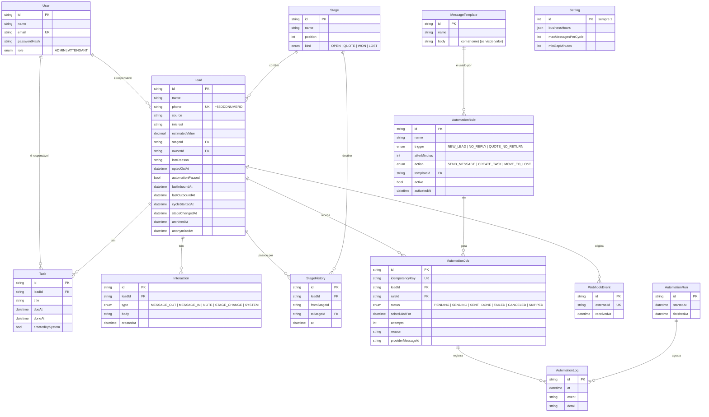

# 05 · Modelo de dados

[← Índice do ciclo de vida](README.md) · [← 04 Arquitetura](04-arquitetura-e-adrs.md) · Próximo: [06 Desenvolvimento e configuração →](06-desenvolvimento-e-configuracao.md)

O modelo espelha `prisma/schema.prisma`: 13 modelos e 6 enumerações, 3 migrations. Nada abaixo é planejado; tudo existe no schema.

## Modelo entidade-relacionamento

Fonte editável: [`diagramas/er.mmd`](diagramas/er.mmd). Mesmo diagrama de [Modelo de dados](../03-arquitetura/01-modelo-de-dados.md).

## Dicionário de dados (entidades centrais)

| Entidade | Campo | Tipo | Restrição e uso |
|---|---|---|---|
| Lead | `phone` | texto | Único; formato +55DDDNÚMERO (RN-13) |
| Lead | `stageId` | texto | FK para `Stage`; indexado |
| Lead | `estimatedValue` | `Decimal(10,2)` | Dinheiro nunca em ponto flutuante |
| Lead | `optedOutAt` | data, opcional | Opt-out (RN-03); só Admin remove |
| Lead | `automationPaused` | booleano, padrão falso | Pausa por lead (RN-10) |
| Lead | `cycleStartedAt` | data, opcional | Início do ciclo sem resposta (RN-08); zerado na resposta |
| Lead | `lastInboundAt`, `lastOutboundAt` | data, opcional | Base de "sem resposta" e do intervalo mínimo |
| Lead | `archivedAt`, `anonymizedAt` | data, opcional | Arquivar e anonimizar (RNF-04) |
| Stage | `kind` | enum `OPEN`, `QUOTE`, `WON`, `LOST` | A automação usa o tipo, não o nome (ADR-006) |
| AutomationRule | `trigger` | enum `NEW_LEAD`, `NO_REPLY`, `QUOTE_NO_RETURN` | Gatilho |
| AutomationRule | `action` | enum `SEND_MESSAGE`, `CREATE_TASK`, `MOVE_TO_LOST` | Ação (RN-16) |
| AutomationRule | `active`, `activatedAt` | booleano, data | Regra nova não age sobre o passado (RN-17) |
| AutomationJob | `idempotencyKey` | texto | **Único**: `regra:lead:instante-do-ciclo` (RN-05) |
| AutomationJob | `status` | enum `PENDING`, `SENDING`, `SENT`, `DONE`, `FAILED`, `CANCELED`, `SKIPPED` | Estados do job |
| AutomationJob | `scheduledFor`, `attempts`, `reason`, `lastError` | data, inteiro, textos | Fila, retentativa e motivo |
| Interaction | `type` | enum `MESSAGE_OUT`, `MESSAGE_IN`, `NOTE`, `STAGE_CHANGE`, `SYSTEM` | Linha do tempo do lead |
| Task | `dueAt`, `doneAt`, `createdBySystem` | datas, booleano | Tarefas, inclusive as criadas pela automação |
| WebhookEvent | `externalId` | texto | **Único**: evento repetido é descartado |
| MessageTemplate | `whatsappTemplateName`, `whatsappLanguage` | texto, opcional e padrão `pt_BR` | Modelo aprovado na Meta |
| Setting | `businessHours`, `maxMessagesPerCycle`, `minGapMinutes` | JSON, inteiros (3 e 720) | Janela, RN-06 e RN-18; uma única linha (`id = 1`) |

## Chaves, índices e integridade

| Garantia | Onde está no schema |
|---|---|
| Telefone único entre leads | `Lead.phone @unique` |
| Mensagem única por intenção de envio | `AutomationJob.idempotencyKey @unique` |
| Evento de webhook processado uma vez | `WebhookEvent.externalId @unique` |
| E-mail único | `User.email @unique` |
| Consulta da fila | `@@index([status, scheduledFor])` em `AutomationJob`; `@@index([leadId])` |
| Linha do tempo e log | `@@index([leadId, createdAt])` em `Interaction`; `@@index([at])` e `@@index([leadId])` em `AutomationLog` |
| Painel e quadro | `@@index([stageId])` e `@@index([ownerId])` em `Lead`; `@@index([toStageId])` em `StageHistory` |
| Remoção em cascata | Interações, tarefas, histórico e jobs saem com o lead (`onDelete: Cascade`); logs ficam com `SetNull` |

## Como o banco impede a mensagem duplicada

A garantia da RN-05 e do [ADR-003](../03-arquitetura/adr/ADR-003-idempotencia.md) tem duas camadas, ambas no banco:

1. **Criação.** A chave `regra:lead:instante-do-ciclo` é calculada em `idempotencyKey` (`src/lib/rules/due-rules.ts`). O motor insere com `createMany` e `skipDuplicates`, que no PostgreSQL vira `INSERT ... ON CONFLICT DO NOTHING` sobre a restrição única. Rodar o ciclo dez vezes cria o job uma vez.
2. **Execução.** Antes de enviar, `updateMany` com `where: { id, status: "PENDING" }` muda para `SENDING`. Só quem atualiza uma linha envia; a outra execução vê zero linhas e segue.

O instante do ciclo (`stamp`) depende do gatilho: criação do lead, início do ciclo sem resposta ou entrada na etapa de orçamento. Se o lead responde e silencia de novo, nasce um ciclo novo, e a chave muda.

Caso difícil: se o processo cair depois da reserva, o job em `SENDING` há mais de 10 minutos vira `FAILED` com o motivo `UNCERTAIN_STATE` e gera uma tarefa. A mensagem pode não sair; não sai duplicada.

O webhook usa a mesma ideia: `WebhookEvent.externalId` único, gravado na mesma transação que processa a resposta (`src/lib/automation/inbound.ts`). O segundo envio do mesmo evento devolve 200 sem reprocessar. Evidências: `tests/integration/engine.test.ts` e `tests/integration/webhook.test.ts`.

## Normalização e justificativas

- Cada assunto tem a sua tabela (lead, etapa, regra, modelo, job, interação, tarefa); `Setting` guarda só valores globais, em uma linha.
- `StageHistory` existe para o painel calcular a passagem entre etapas sem depender de texto livre.
- O sistema guarda o texto das mensagens em `Interaction.body`; CPF, endereço e e-mail do lead não são coletados ([segurança e privacidade](../03-arquitetura/04-seguranca-e-privacidade.md)).
- O lead arquivado continua ocupando o telefone, para não haver dois históricos do mesmo contato.

## Migrations e seeds

| Migration | Conteúdo |
|---|---|
| `20261022193100_init` | Schema inicial |
| `20261022193242_add_done_status_and_min_gap` | Status `DONE` e `minGapMinutes` (RN-18) |
| `20261023134951_add_whatsapp_template_fields` | Campos do modelo aprovado na Meta (RSK-08) |

| Seed | Para quê |
|---|---|
| `prisma/seed.ts` | Demonstração: contas de teste, etapas e leads fictícios da Casa Nova Reformas |
| `prisma/seed-pilot.ts` | Piloto: etapas, modelos e regras desligadas, sem contas nem leads |

## Retenção, auditoria, privacidade e acesso

Coleta mínima: nome, telefone e o que a venda exige. O opt-out bloqueia envios, e `anonymizeLead` remove nome, telefone, interesse, motivo, interações e tarefas, mantendo só o necessário para as contagens do painel (RNF-04). Todo serviço confere papel antes de ler ou escrever (`src/lib/auth/permissions.ts`). A trilha de auditoria da automação são `AutomationLog` e `AutomationRun`. Não há política de retenção por prazo no código.

## Fluxo dos dados

Criação: cadastro ou importação CSV cria `Lead`, `StageHistory` e `Interaction`. Atualização: o motor altera `AutomationJob` e `Lead` (ciclo, último envio) em cada ciclo; a resposta zera o ciclo e cria `Task`. Consulta: quadro, linha do tempo, painel e log leem `Lead`, `Interaction`, `StageHistory`, `AutomationJob` e `AutomationLog`.
