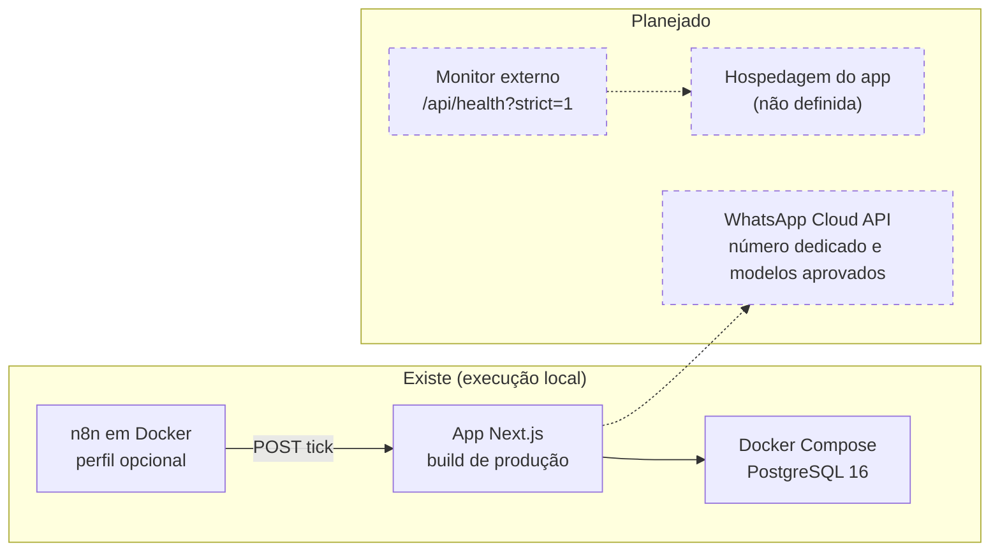

# 08 · Implantação, operação e adoção

[← Índice do ciclo de vida](README.md) · [← 07 Testes e qualidade](07-testes-e-qualidade.md) · Próximo: [09 Evolução e roadmap →](09-evolucao-e-roadmap.md)

Este documento separa o que existe e foi executado do que está planejado. Nenhum procedimento de implantação, rollback ou runbook foi executado em um ambiente real, e não houve uso por usuário real.

## Situação de cada elemento

| Elemento | Situação | Documento |
|---|---|---|
| Execução local com Postgres e n8n em Docker | Existe e foi executada | [CONTRIBUTING.md](../../CONTRIBUTING.md) |
| Build de produção e E2E contra ele | Existe e foi executado (CI e logs) | [Qualidade](../05-qualidade/README.md) |
| Migrations em banco vazio e seed de piloto | Existe; migrations e seed cobertos por teste (`seed-pilot.test.ts`) | [Rollout](../06-go-live/rollout.md) |
| Fluxo do n8n | Versionado; executado uma vez, sem log arquivado | [n8n](../06-go-live/n8n.md) |
| Hospedagem da aplicação | **Planejada**; sem ambiente definido e sem deploy | — |
| Envio real pela WhatsApp Cloud API | **Planejado**; adaptador nunca validado contra a Meta | [Rollout, fase 2](../06-go-live/rollout.md) |
| Rollback, runbook e treinamento | **Planejados**; nenhum foi ensaiado ou aplicado | [Rollback](../06-go-live/rollback.md), [Runbook](../07-pos-go-live/runbook.md), [Treinamento](../06-go-live/treinamento.md) |
| Monitor externo do agendador | **Planejado**; o endpoint existe, o monitor não foi cadastrado | [Runbook](../07-pos-go-live/runbook.md) |

## Arquitetura de implantação

## Ambientes e configuração

| Ambiente | Banco | Observação |
|---|---|---|
| Desenvolvimento e demonstração | `pulso` | Seed de demonstração com contas de teste |
| Integração | `pulso_test` | O código recusa limpar um banco cujo nome não termine em `_test` |
| E2E | `pulso_e2e` | Recriado com seed a cada execução; servidor na porta 3100 |
| CI | Postgres 16 do job | Variáveis de teste no workflow |
| Produção | Não existe | Configuração por variáveis de ambiente, listadas em [Desenvolvimento e configuração](06-desenvolvimento-e-configuracao.md#gestão-de-ambientes-e-configuração) |

Dependências externas: PostgreSQL, n8n (agendador) e, para envio real, a conta e o número dedicado na Meta com modelos aprovados.

## Plano de implantação e estratégia de rollout

O rollout começa **sem envio**: nas duas primeiras fases só há lembretes para a atendente, porque o envio real não foi validado e o provedor simulado registraria "enviada" sem enviar. Detalhe e critérios: [Rollout](../06-go-live/rollout.md).

| Fase | O que acontece | Critério para avançar |
|---|---|---|
| 0. Preparação (1 a 2 dias) | Seed de piloto, contas reais, importação dos leads da planilha com automação pausada, treinamento | Dados e contas prontos |
| 1. Funil e lembretes (semanas 1 e 2) | Uma regra de tarefa por vez, com um dia de intervalo | Duas semanas de uso, sem erro inesperado nem tarefa duplicada, e ao menos um lead real com lembrete no prazo |
| 2. Pré-requisitos do envio real | Conta verificada, modelos aprovados, adaptador e webhook testados na Meta | Todos os itens abertos concluídos |
| 3. Envio real em pequeno | Primeiro só "boas-vindas" para os leads novos de uma semana | Critérios de parada do rollback não acionados |

## Plano de rollback

Do mais rápido ao mais invasivo ([Rollback](../06-go-live/rollback.md)): parar o agendador (segundos), esvaziar a fila (cerca de 1 minuto), travar o endpoint (cerca de 2 minutos), pausar por lead e desligar regras uma a uma. Desligar uma regra cancela o que ela tinha na fila (RN-19, coberto por teste de integração). Gatilhos para parar na hora: mensagem duplicada, fora do horário, para quem pediu SAIR ou que já tinha respondido, ou com texto quebrado.

## Migração e preparação dos dados

O seed de piloto (`db:seed:pilot`) cria etapas, modelos e regras desligadas, sem contas nem leads; as contas reais saem do script `user:create`. A planilha entra por importação CSV (até 500 leads por arquivo, relatório das linhas ignoradas), com a automação pausada por padrão ([RF-20](../02-definicao/02-requisitos.md)). Instruções de execução: [CONTRIBUTING.md](../../CONTRIBUTING.md).

## Treinamento, documentação operacional e onboarding

Duas sessões com o app aberto e dados de demonstração: atendente (90 minutos) e dono (30 minutos), cada uma com teste de saída. [Treinamento](../06-go-live/treinamento.md) é proposta e nunca foi aplicada. O [Runbook](../07-pos-go-live/runbook.md) descreve papéis, rotina diária, problemas e o que não fazer.

## Monitoramento, logs, alertas e suporte

| Recurso | O que mostra | Estado |
|---|---|---|
| `/api/health` | Banco, provedor e `automation` (`ok`, `stale` ou `never`); com `?strict=1`, devolve 503 com o agendador parado | Existe e é testado (`health.test.ts`) |
| Log da automação | Toda decisão do motor, com motivo e o evento "Atrasado" | Existe ([galeria](../imagens/README.md#7-log-da-automação)) |
| Painel | Último ciclo, leads por etapa, mensagens enviadas e falhas | Existe |
| Alerta por e-mail | Aviso quando o monitor externo disparar | Planejado |
| Suporte | A atendente avisa o dono, que decide pausar; quem opera trata banco, n8n e segredos | Proposto no runbook |

## Indicadores de adoção e critérios de sucesso

Na fase 1, sem envio real, medem-se M2 (nenhum orçamento sem ação em 48 h, agora por tarefa), M5 (motivo de perda registrado) e M6 (uso diário da atendente). M1, M3 e M4 só fazem sentido com envio real. Todas são hipóteses, sem medição. Definições: [Visão e metas](../02-definicao/01-visao-e-metas.md).

## Riscos operacionais e continuidade

| Risco | Mitigação | Estado |
|---|---|---|
| Agendador parado sem ninguém perceber (RSK-04) | Estado no banco, recuperação do atraso, evento "Atrasado" e health | Monitor externo pendente |
| Bloqueio do número por excesso de mensagens (RSK-01) | Limites, janela comercial, opt-out e rollout em pequeno | Só vale com envio real |
| Modelos exigidos pela Meta (RSK-08) | Modelo aprovado com variáveis como parâmetros | Sem teste real |
| Envio duplicado (RSK-02) | Chave única e reserva atômica | Coberto por teste |

Continuidade: se o n8n cai, nada se perde, e o próximo ciclo processa o atraso respeitando a janela comercial ([Modos de falha](../03-arquitetura/05-modos-de-falha.md)).
