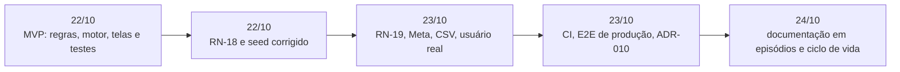

# 09 · Evolução e roadmap

[← Índice do ciclo de vida](README.md) · [← 08 Implantação e operação](08-implantacao-e-operacao.md) · [Sprints](sprints/README.md)

## Histórico de versões

O repositório não tem tags, releases nem CHANGELOG; `package.json` declara `1.0.0`. A evolução está nos commits ([linha do tempo real](06-desenvolvimento-e-configuracao.md#linha-do-tempo-real-dos-commits)) e nas três migrations do schema. As mudanças relevantes, em ordem:

| Mudança | Commit | Motivo | Impacto |
|---|---|---|---|
| RN-18: intervalo mínimo de 12 h entre mensagens | `b6873ed`, `9a98212` | Evitar rajada quando o ciclo fica parado | Migration `add_done_status_and_min_gap`, nova trava em `guards.ts` |
| Seed alinhado à tela de login | `280f792` | Seed e docs divergiam | Contas e etapas da Casa Nova Reformas |
| RN-19, log "Atrasado", health do agendador | `d654fab` | Lacunas do preparo do go-live | Desativar regra cancela a fila; `/api/health` informa o agendador |
| Modelo aprovado da Meta | `d654fab` | RSK-08 | Migration `add_whatsapp_template_fields` |
| Webhook nativo da WhatsApp Cloud API | `27c70c2` | Receber respostas direto da Meta | Rota `/api/webhooks/whatsapp-cloud` |
| Importação por CSV e seed de piloto | `a2d5319` | Migrar a planilha e começar um piloto sem dados de demonstração | RF-20; leads entram com a automação pausada |
| Remoção do `loading.tsx` | `1cb4fd7` | Defeito só no build de produção | [ADR-010](../03-arquitetura/adr/ADR-010-sem-loading-tsx.md); E2E passa a rodar contra o build |

## Solicitações de mudança e seus impactos

| Pedido | Decisão | Impacto |
|---|---|---|
| Arrastar e soltar no quadro | Adiado | Nenhum no MVP; o seletor "Mover" entrega o mesmo |
| Chatbot que responde sozinho | Recusado | Evita resposta errada em nome da empresa; fora do escopo |
| Mensagem "só desta vez" às 22h | Recusado | Mantém RN-01; alternativa: tarefa para ligar de manhã |
| Pré-visualização da mensagem | Aceito em parte | Entrou a prévia do modelo; a aprovação mensagem a mensagem foi recusada |
| Pausar automação por lead | Aceito | RF-12 e RN-10 |
| "Próximo passo da automação" no lead | Aceito | Bloco calculado a partir dos jobs pendentes |
| Painel com previsão de receita | Adiado | Depende de histórico que o piloto não tem |
| Alerta por WhatsApp quando o lead responde | Adiado | A tarefa "Responder" em Hoje basta no piloto |
| Escolher, regra a regra, só lembrar a atendente | Aceito | Ação "criar tarefa" (RN-16) |
| Telas e ações no celular | Aceito | Detalhe empilhado e botões maiores no mobile |

Fonte: [Validação do protótipo](../04-prototipo/02-validacao-do-prototipo.md).

## Problemas identificados e ações corretivas

Os seis defeitos documentados, com causa e correção, estão em [Testes e qualidade](07-testes-e-qualidade.md#registro-de-defeitos-e-causa-raiz). As ações abertas estão na [retrospectiva](../07-pos-go-live/retrospectiva.md).

## Dívida técnica priorizada

| Prioridade | Item | Por que nessa ordem |
|---|---|---|
| 1 | Validar o adaptador da Meta na sandbox | Bloqueia o envio real (RSK-08) |
| 2 | Cadastrar o monitor externo do agendador | Fecha o RSK-04 |
| 3 | Testar o agendamento do n8n por horas | Hoje só há uma execução |
| 4 | Ensaiar rollback e runbook | São planos sem ensaio |
| 5 | Teste automático de RNF-05, acessibilidade e carga | Lacunas de qualidade conhecidas |
| 6 | Tags, releases e CHANGELOG | Sem versão marcada |
| 7 | Recuperação de senha e limite de tentativas de login | [ADR-008](../03-arquitetura/adr/ADR-008-autenticacao.md) |

## Roadmap de evolução

| Versão (plano) | Conteúdo | Justificativa de negócio |
|---|---|---|
| v1.1 | Go-live em modo lembrete (fases 0 e 1 do rollout) | Recuperar orçamentos sem risco de mensagem errada em nome do dono |
| v1.2 | Envio real em pequeno (fases 2 e 3) | Entregar o follow-up automático de fato, depois da validação com a Meta |
| v1.3 | Arrastar e soltar; alerta por WhatsApp; painel com previsão de receita | Pedidos adiados, quando houver histórico de uso |
| Futuro | Multiempresa, mídia e áudio | Fora do escopo atual, com custo alto no modelo de dados |

## Lições aprendidas e melhorias de processo

Da [retrospectiva](../07-pos-go-live/retrospectiva.md): rodar o E2E contra o build de produção desde o início, escrever a matriz de rastreabilidade a partir do que existe, criar a CI e o remoto no começo, começar o go-live por uma lista de "o que quebra no mundo real" e testar o adaptador da Meta mais cedo, porque a exigência de modelos aprovados muda o produto.
