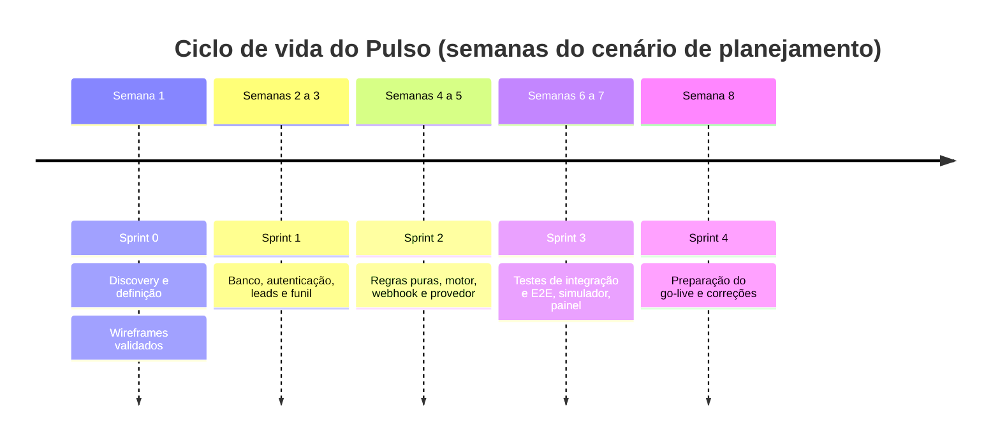

# Ciclo de vida do Pulso

Relatório do ciclo de vida de software do Pulso, do problema comercial à evolução: discovery, requisitos, planejamento ágil, arquitetura, dados, desenvolvimento, qualidade, implantação e melhoria contínua. Cada página liga decisão, implementação, teste e resultado, e aponta para o arquivo que sustenta a afirmação.

[← Capa](../../README.md) · [Guia da série](../INDEX.md) · [Glossário](../GLOSSARIO.md)

## Documentos

| # | Documento | O que responde |
|---|---|---|
| 01 | [Visão e discovery](01-visao-e-discovery.md) | Qual problema, para quem, com quais restrições? |
| 02 | [Planejamento e Scrum](02-planejamento-e-scrum.md) | Como o trabalho foi organizado em sprints, riscos e cerimônias? |
| 03 | [Requisitos e rastreabilidade](03-requisitos-e-rastreabilidade.md) | Como a necessidade chegou ao código e ao teste? |
| 04 | [Arquitetura e ADRs](04-arquitetura-e-adrs.md) | Como o sistema é composto e por que assim? |
| 05 | [Modelo de dados](05-modelo-de-dados.md) | Como o banco impede a mensagem duplicada? |
| 06 | [Desenvolvimento e configuração](06-desenvolvimento-e-configuracao.md) | Como o repositório evoluiu e o que a CI executa? |
| 07 | [Testes e qualidade](07-testes-e-qualidade.md) | O que foi testado, o que falhou e o que falta? |
| 08 | [Implantação e operação](08-implantacao-e-operacao.md) | Como entraria em uso e como seria operado? |
| 09 | [Evolução e roadmap](09-evolucao-e-roadmap.md) | O que mudou, o que ficou como dívida e o que vem depois? |
| — | [Reuniões](reunioes/README.md) · [Sprints](sprints/README.md) · [Diagramas](diagramas/README.md) | Registros do cenário, páginas de sprint e fontes dos diagramas |

## Linha do tempo

Os commits têm data real e estão entre 22/10/2026 e 24/10/2026; a tabela do [documento 06](06-desenvolvimento-e-configuracao.md#linha-do-tempo-real-dos-commits) lista cada um. As semanas acima organizam o cenário de planejamento e não substituem essas datas.

## Marcos verificáveis

| Marco | Evidência |
|---|---|
| Discovery e escolha da ideia | [Brainstorm](../01-discovery/01-brainstorm-e-escolha.md), commit `8250ab4` |
| Regras, requisitos e ADRs | [Episódio 2](../02-definicao/README.md) e [Episódio 3](../03-arquitetura/README.md), commit `4977200` |
| Schema, regras puras e motor | commits `9a98212`, `8287eff`, `91b341f` |
| Suítes de integração e E2E | commits `b0f0c57`, `3450f06`, `286f650` |
| Correção do `loading.tsx` | [ADR-010](../03-arquitetura/adr/ADR-010-sem-loading-tsx.md), commit `1cb4fd7` |
| CI verde na `main` | [run 39980673278](https://github.com/Joaogabrielmaia/Automated-CRM-follow-up-on-WhatsApp/actions/runs/39980673278), commit `cbbcc47` |
| Testes executados e registrados | [Logs de 24/10/2026](../05-qualidade/README.md), commit `cbbcc47` |

## Como ler as evidências

- **Observado:** consta no repositório ou saiu de execução registrada (commits, logs, runs da CI, código, schema).
- **Planejamento do cenário:** sprints, cerimônias e papéis Scrum descrevem como o trabalho seria conduzido num contexto acadêmico. Estão identificados como tal na [nota de contexto](#nota-de-contexto-acadêmico).
- **Ilustrativo:** nenhum resultado numérico deste relatório é ilustrativo. Os números vêm de logs, do ADR-010 (tabela do autor) ou da contagem de linhas de documentos.

## Nota de contexto acadêmico

Este material integra um estudo de caso. A empresa, as pessoas e os dados são fictícios, e as reuniões de discovery e de validação do protótipo são registros simulados, identificados por papel. Cronogramas, sprints e cerimônias foram elaborados para compor o cenário de aprendizagem; suas semanas não correspondem a datas de commits, releases ou execuções.

A inteligência artificial foi usada na construção do cenário: nos papéis do dono, da atendente e da cliente-tipo dos registros de discovery e da validação do protótipo, e na redação e revisão da documentação. Os resultados de testes e da CI citados aqui vêm de execuções reais, com data e commit.
